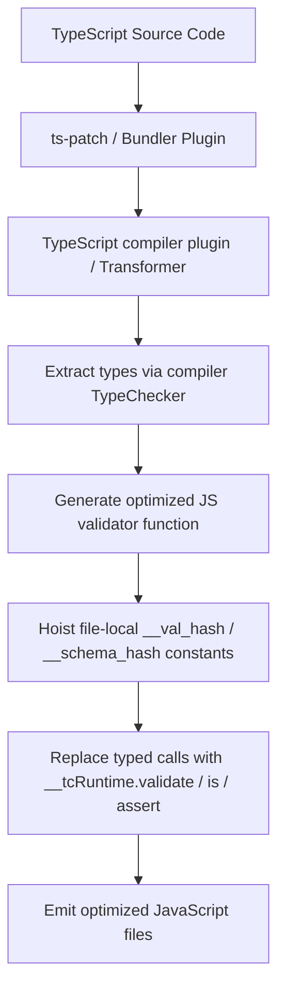

# @webergency-utils/typechecker

An ahead-of-time (AOT) TypeScript validation engine that compiles types into optimized runtime validators via a compiler transformer—no runtime reflection and no third-party schema library.

[](https://www.npmjs.com/package/@webergency-utils/typechecker)
[](https://www.npmjs.com/package/@webergency-utils/typechecker)
[](#maintenance)
[](https://www.npmjs.com/package/@webergency-utils/typechecker?activeTab=dependencies)
[](https://www.npmjs.com/package/@webergency-utils/typechecker)
<br>
[](https://securityscorecards.dev/viewer/?uri=github.com/webergency-utils/typechecker)
[](https://codecov.io/gh/webergency-utils/typechecker)
[](https://github.com/webergency-utils/typechecker/actions/workflows/ci.yml)
[](https://github.com/webergency-utils/typechecker/actions/workflows/codeql.yml)

## TL;DR

```typescript
import { validate, constraint, format } from '@webergency-utils/typechecker';

interface User {
  id: string & format.UUID;
  name: string & constraint.MinLength<2>;
  age: number & constraint.Minimum<18>;
}

const input: unknown = {
  id: '550e8400-e29b-41d4-a716-446655440000',
  name: 'Alice',
  age: 25,
};

// Validate input against the User type definition
const result = validate<User>(input);

if (result.success) {
  // TypeScript narrows type to User here
  console.log('User is valid:', result.data);
} else {
  console.error('Validation failed:', result.errors);
}
```

## Installation & Setup

This package is a TypeScript compiler plugin (transformer). You must compile with a compiler patcher such as `ts-patch` so the transformer can hook into `tsc`.

**Requirements:** Node.js `>=22.0.0` and peer dependency `typescript` `>=5.0.0` (provides the compiler API the transformer and language service plugin use).

There are **no runtime `dependencies`**—only the peer `typescript` and your build tooling.

### 1. Install Dependencies

Install the core package, along with `ts-patch` as a development dependency:

```bash
npm install @webergency-utils/typechecker
npm install --save-dev ts-patch
```

### 2. Inject Compiler Hook

Run the patcher command to set up `ts-patch` inside your local TypeScript installation:

```bash
npx ts-patch install
```

> [!NOTE]
> It is recommended to add `ts-patch install` to your `package.json` `prepare` script so it runs automatically after every dependency installation.

### 3. Configure tsconfig.json

Register the typechecker **transformer** (and optionally the language service plugin) under `compilerOptions.plugins` in `tsconfig.json`:

```json
{
  "compilerOptions": {
    "target": "ES2022",
    "module": "NodeNext",
    "moduleResolution": "NodeNext",
    "plugins": [
      { "transform": "@webergency-utils/typechecker/transformer" },
      { "name": "@webergency-utils/typechecker/plugin" }
    ]
  }
}
```

The `transform` entry is required for AOT validation. The `name` entry enables IDE constraint diagnostics via the language service plugin.

### 4. Bundler Plugins (Optional — Vite, Rollup, Webpack, esbuild)

If your project bundles with Vite, Rollup, Webpack, or esbuild instead of `tsc` + `ts-patch`, register the built-in bundler plugin from `@webergency-utils/typechecker/vite` or `@webergency-utils/typechecker/unplugin`:

```typescript
// vite.config.ts
import { defineConfig } from 'vite';
import typecheckerVite from '@webergency-utils/typechecker/vite';

export default defineConfig({
  plugins: [
    typecheckerVite({
      tsconfig: './tsconfig.json',
    }),
  ],
});
```

Rollup (`@webergency-utils/typechecker/rollup`), Webpack (`@webergency-utils/typechecker/webpack`), and esbuild (`@webergency-utils/typechecker/esbuild`) each expose a dedicated default export, and all adapters are also exported from `@webergency-utils/typechecker/unplugin`:

```typescript
import {
  typecheckerRollup,
  typecheckerWebpack,
  typecheckerEsbuild,
} from '@webergency-utils/typechecker/unplugin';
```

The plugin runs with `enforce: 'pre'` so AOT macros are transformed before downstream TypeScript/SWC/esbuild transpilers strip type arguments.
---

## Architecture & Internals

The package utilizes a custom TypeScript compiler transformer and language service plugin to deliver highly efficient type-safe runtime validations.

### Build-Time Compilation Flow



1. **Build-Time Transformation**: The compiler transformer intercepts typed helper calls (`validate`, `is`, `assert`, `assertGuard`, `validator`, `jsonSchema`, `standardSchema`, `parse`, `parser`, `safeParse`, `stringify`, `serializer`, `safeSerialize`, `clone`, `cloner`, `prune`, `pruner`, `random`, `randomGenerator`). Schema helpers (`validateSchema`, `isSchema`, `assertSchema`, `assertGuardSchema`, `compileSchema`, `getOrCompileSchema`) are plain runtime APIs and do not require transformation.
2. **Type Extraction & Analysis**: It parses the target TS type structure via a cached `TypeNode` IR, extracting intersection constraints, formats, transforms, access modifiers (`ReadOnly`, `WriteOnly`, `Secret`), and defaults recursively.
3. **File-local validators**: The transformer generates highly optimized JavaScript validator, parser, serializer, cloner, pruner, and arbitrary generator functions for each resolved type shape, names them with a structural hash (`__val_<hash>` / `__schema_<hash>` / `__parse_<hash>` / `__ser_<hash>` / `__clone_<hash>` / `__prune_<hash>` / `__rand_<hash>`), and hoists them in the same file.
4. **Call Replacement & Tree-Shaking**: Typed calls are rewritten to `@webergency-utils/typechecker/runtime` helpers (`validators.js`, `parse-runtime.js`, `serializer-runtime.js`, `clone-runtime.js`, `random-runtime.js`) with no global registry lookup and zero duplicate runtime bundling across entrypoints. The runtime JSON Schema compiler lives in a dedicated subpath (`@webergency-utils/typechecker/runtime/schema-compiler`) so applications using only AOT macros tree-shake `compileSchema` automatically.

### External dependencies

- **Required peer:** `typescript` (`>=5.0.0`) — compiler API for the transformer and optional language service plugin.
- **Build tooling:** `ts-patch` (for `tsc` builds) or `@webergency-utils/typechecker/unplugin` / `@webergency-utils/typechecker/vite` (for Vite, Rollup, Webpack, and esbuild).
- **Runtime dependencies:** none.

### Static Constraint Diagnostics

The package includes an IDE / Language Service plugin that statically checks literal values against type constraints during editing or compilation:

```typescript
import { constraint } from '@webergency-utils/typechecker';

// This yields a compilation error directly in the IDE:
// Type '5' is not assignable to type 'number & Minimum<18>'.
const age: number & constraint.Minimum<18> = 5;
```

---

## Glossary

- [`validate`](src/index.ts): Validates a value against a type, returning a structured result containing the validation status and a detailed list of errors.
- [`is`](src/index.ts): A type guard for `T`. Always mutates in place; `from` may coerce nested fields. Root replacement fails the guard.
- [`assert`](src/index.ts): Validates a value and returns it, throwing a validation error on failure (supports `from` coercion).
- [`assertGuard`](src/index.ts): Asserts a value is `T`. Always mutates in place; `from` may coerce nested fields. Root replacement throws.
- [`validator`](src/index.ts): AOT macro that compiles a reusable `CompiledValidator<ResolveDefaults<T>, T>` callable with `.validate()`, `.is()`, `.assert()`, `.assertGuard()`, and `['~standard']` (Standard Schema v1).
- [`standardSchema`](src/index.ts): AOT macro that returns a Standard Schema v1 (`StandardSchemaV1<T, ResolveDefaults<T>>`) wrapper for `T`.
- [`serializer`](src/index.ts): AOT macro that compiles a reusable `CompiledSerializer<SerializeInput<T>>` callable with `.stringify()`, `.safe()`, and `.safeSerialize()` for JSON or query strings. Default `transform` / `replacer` are closed over at create time and can be overridden per call.
- [`stringify`](src/index.ts): AOT macro that structurally checks and serializes a value of type `SerializeInput<T>` (omitting `tag.WriteOnly` and `tag.Secret` properties). `transform` / `replacer` are per-call.
- [`safeSerialize`](src/index.ts): AOT macro that structurally checks and serializes a value without throwing, returning `SafeSerializeResult` (`{ success: true, data: string }` or `{ success: false, error: SerializationError }`).
- [`parse`](src/index.ts): AOT macro that parses wire inputs (`from: 'json' | 'query' | 'string' | 'formData' | 'headers'`) into `ParseOutput<T>`. Optional `reviver`, `transform`, and compile-time `propertyCasing`.
- [`parser`](src/index.ts): AOT macro that compiles a reusable `CompiledParser<ParseOutput<T>, Input>` callable with `.parse()`, `.safe()`, `.safeParse()`, and `['~standard']` (Standard Schema v1). Default `reviver` / `transform` are closed over at create time and can be overridden per call.
- [`safeParse`](src/index.ts): AOT macro that parses and validates wire inputs without throwing, returning `SafeParseResult<ParseOutput<T>>` (`{ success: true, data }` or `{ success: false, error: ParseError }`).
- [`clone`](src/index.ts) / [`cloner`](src/index.ts): AOT deep-cloner macros that allocate fresh containers/exotics for `T` while omitting undeclared excess object keys.
- [`prune`](src/index.ts) / [`pruner`](src/index.ts): AOT in-place structural excess-key stripper macros for `T` (skipping subtrees that cannot hold excess object keys).
- [`random`](src/index.ts) / [`randomGenerator`](src/index.ts): AOT arbitrary/mock value generator macros honoring type constraints, formats, regex patterns, and JSDoc bounds (deterministic when a numeric `seed` is passed).
- [`TransformFn`](src/runtime/transform.ts) / [`TransformContext`](src/runtime/transform.ts): Typed per-node rewrite on `parse` / `stringify` / `assert` / `validate` (`ctx.type`, `ctx.path`, `ctx.tags`). Not used by `is` / `assertGuard`.
- [`JsonReviver`](src/runtime/transform.ts) / [`JsonReplacer`](src/runtime/transform.ts): `JSON.parse` / `JSON.stringify` callbacks. Reviver also walks decoded query, `FormData`, and header objects. Replacer is JSON stringify only.
- [`tag`](src/runtime/tags/tag.ts): Named metadata (`tag<'html'>`) peeled into `ctx.tags` and JSON Schema `x-tags`; `tag.Default` fills missing properties; `tag.ReadOnly`, `tag.WriteOnly`, and `tag.Secret` control directional wire visibility and secret redaction.
- [`jsonSchema`](src/index.ts): Generates and returns a JSON Schema representation matching a TypeScript type at compile time (supports `'draft-07'` default, `'draft-2020-12'`, `'openapi-3.0'`, and `'openapi-3.1'` targets, with `x-typescript-type` for `Date`/`URL`/`RegExp`/`Set`/`Map`/`bigint`/etc. and `x-tags` for `tag<'html'>`).
- [`validateSchema`](src/index.ts) / [`isSchema`](src/index.ts) / [`assertSchema`](src/index.ts) / [`assertGuardSchema`](src/index.ts): Same entrypoints against a runtime JSON Schema value instead of a TypeScript generic.
- [`compileSchema`](src/runtime/schema-compiler.ts) / [`getOrCompileSchema`](src/runtime/schema-compiler.ts): Compiles (or WeakMap-caches) a runtime JSON Schema into a `CompiledSchema<T>` validator function with Standard Schema v1 (`~standard`) support.
- [`WithModifiers`](src/runtime/tags.ts): A utility type that applies constraint, format, or transformation tags to properties of deeply nested or external types using dot-separated path mappings.
- [`ResolveDefaults`](src/runtime/tags.ts): A helper type that removes the optional flag (`?`) from properties that have defined default values.
- [`convertPropertyCasing`](src/runtime/casing.ts): A runtime utility to recursively change the casing of object keys.
- [`toZodIssues`](src/runtime/validators.ts) / [`groupErrorsByPath`](src/runtime/validators.ts): Transform or group validation errors (including nested union `issues`).
- [`ZodLikeError`](src/runtime/validators.ts): Error class wrapping validation errors in a structure compatible with libraries expecting Zod errors.
- [`@webergency-utils/typechecker/transformer`](src/transformer.ts): `ts-patch` transform entry for AOT rewrite.
- [`@webergency-utils/typechecker/unplugin`](src/unplugin.ts) / [`@webergency-utils/typechecker/vite`](src/unplugin.ts): Bundler plugin adapters for Vite, Rollup, Webpack, and esbuild.
- [`@webergency-utils/typechecker/plugin`](src/plugin.ts): Optional language-service plugin for IDE static constraint diagnostics.

---

## API Reference

### Validation Functions

#### `validate<T>(input: unknown, options?: ValidationMode | ValidationOptions): IValidation<ResolveDefaults<T>>`

Validates input data against type `T` and returns a structured validation result.

- **Parameters**:
  - `input`: The value to validate.
  - `options` (optional): Either a `ValidationMode` string (`'strict' | 'relaxed' | 'strip'`) or a `ValidationOptions` object (`transform` is opt-in; not used by `is` / `assertGuard`).
- **Returns**: `IValidation<ResolveDefaults<T>>` containing validation status, converted/stripped data, and error details.
- **Example**:
  ```typescript
  const result = validate<User>(data, 'strip');
  ```

#### `is<T>(input: unknown, options?: ValidationMode | GuardOptions): input is ResolveDefaults<T>`

A type guard for type `T`. Always mutates in place (no `mutate` option). `from` may coerce nested fields onto the same object; if validation would replace the root value (e.g. primitive `"42"` → `42`), returns `false`.

- **Parameters**:
  - `input`: The value to check.
  - `options` (optional): Either a `ValidationMode` string or a `GuardOptions` object.
- **Returns**: `boolean` (`true` if valid, `false` otherwise). Narrows type of `input` to `ResolveDefaults<T>` on success.
- **Example**:
  ```typescript
  if (is<User>(data)) {
    console.log(data.name);
  }
  ```

#### `assert<T>(input: unknown, options?: ValidationMode | AssertOptions): ResolveDefaults<T>`

Validates input data and returns it, throwing a validation error on failure.

- **Parameters**:
  - `input`: The value to validate.
  - `options` (optional): Either a `ValidationMode` string or an `AssertOptions` object (`transform` is opt-in; not used by `is` / `assertGuard`).
- **Returns**: `ResolveDefaults<T>` (the validated value with defaults resolved).
- **Throws**: `Error` containing a list of path and constraint failures, or a custom error via `options.errorFactory`.
- **Example**:
  ```typescript
  const user = assert<User>(data);
  ```

#### `assertGuard<T>(input: unknown, options?: ValidationMode | AssertGuardOptions): asserts input is ResolveDefaults<T>`

An assertion guard for type `T`. Always mutates in place (no `mutate` option). `from` may coerce nested fields; root replacement fails with a normal type error (re-checked without `from`).

- **Parameters**:
  - `input`: The value to check.
  - `options` (optional): Either a `ValidationMode` string or an `AssertGuardOptions` object.
- **Returns**: `void`. Narrows the type of `input` in the enclosing scope on success.
- **Throws**: `Error` if validation fails (or a custom error via `options.errorFactory`).
- **Example**:
  ```typescript
  assertGuard<User>(data);
  ```

#### `validator<T>(options?: ValidationMode | ValidationOptions): CompiledValidator<ResolveDefaults<T>, T>`

Compiles a reusable first-class validator object for type `T` with default options closed over at creation time. The returned `CompiledValidator` is directly callable (`(input, overrideOptions?) => IValidation<ResolveDefaults<T>>`), exposes `.validate()`, `.is()`, `.assert()`, and `.assertGuard()` methods, and implements `StandardSchemaV1` (`['~standard']`).

- **Parameters**:
  - `options` (optional): Default `ValidationMode` or `ValidationOptions` applied when callers do not pass per-call overrides.
- **Returns**: `CompiledValidator<ResolveDefaults<T>, T>`.
- **Example**:
  ```typescript
  import { validator } from '@webergency-utils/typechecker';

  const checkUser = validator<User>({ mode: 'strip', from: 'query' });

  const res = checkUser(rawInput);       // IValidation<ResolveDefaults<User>>
  if (checkUser.is(rawInput)) { /* narrowed */ }
  const user = checkUser.assert(rawInput);
  ```

#### `standardSchema<T>(options?: ValidationMode | ValidationOptions): StandardSchemaV1<T, ResolveDefaults<T>>`

Creates a [Standard Schema v1](https://standardschema.dev) (`~standard`) object for type `T`, compatible with tRPC, TanStack Router/Form, Hono, and other Standard Schema consumers.

- **Example**:
  ```typescript
  import { standardSchema } from '@webergency-utils/typechecker';

  const userSchema = standardSchema<User>({ mode: 'strip' });
  ```

#### `jsonSchema<T>(options?: JsonSchemaTarget | JsonSchemaOptions): JsonSchema`

Generates a JSON Schema object matching type `T` at compile time.

- **Parameters**:
  - `options` (optional): Target dialect string or `{ target?: JsonSchemaTarget, propertyCasing?: CasingFormat }`:
    - `'draft-07'` (default): JSON Schema Draft-07 (`items` array + `additionalItems` for tuples, `$defs`).
    - `'draft-2020-12'`: JSON Schema Draft 2020-12 (`$schema`, `prefixItems` + `items` for tuples, `$defs`).
    - `'openapi-3.0'`: OpenAPI 3.0 Schema Object (`nullable: true` instead of `[T, 'null']` / `anyOf` null unions, `minimum` + `exclusiveMinimum: true`, `#/components/schemas/...` `$ref`s).
    - `'openapi-3.1'`: OpenAPI 3.1 dialect (`$schema: 'https://spec.openapis.org/oas/3.1/dialect/base'`, `prefixItems`).
    - `propertyCasing`: Optional compile-time `CasingFormat` mapping TypeScript property names to wire keys (`properties`, `required`, `requires`).
- **Returns**: `JsonSchema` (a fresh JSON Schema object).
- **Example**:
  ```typescript
  const draft07 = jsonSchema<User>();
  const draft2020 = jsonSchema<User>({ target: 'draft-2020-12' });
  const snakeSchema = jsonSchema<User>({ propertyCasing: 'snake_case' });
  const openApi30 = jsonSchema<User>('openapi-3.0');
  ```

#### `validateSchema<T = unknown>(schema: JsonSchema, input: unknown, options?: ValidationMode | ValidationOptions): IValidation<T>`

Validates `input` against a **runtime JSON Schema** value (not a TypeScript generic).

Only the documented schema subset is compiled. Supported keywords include core types and constraints,
`allOf` / `anyOf` / `oneOf` / `not` / `enum` / `if`/`then`/`else`, local `$ref` (including `#/$defs/...`, `#/definitions/...`, and OpenAPI `#/components/schemas/...`) / `$anchor` /
`$dynamicRef` / `$dynamicAnchor` / `$recursiveRef` / `$recursiveAnchor`, `const`, type arrays, OpenAPI 3.0 `nullable: true`,
`patternProperties`, `propertyNames`, `dependencies` / `dependentRequired` / `dependentSchemas`,
`contains` / `minContains` / `maxContains`, `prefixItems` / `additionalItems`,
`unevaluatedProperties` / `unevaluatedItems` (draft 2019-09 / 2020-12 annotation collection across
in-place applicators including sibling `allOf` arms; zero annotation overhead when `unevaluated*` is absent), `minProperties` / `maxProperties`,
`contentEncoding` / `contentMediaType` / `contentSchema`, and draft-04 boolean
`exclusiveMinimum` / `exclusiveMaximum`. Remote `http(s)` `$ref` values are rejected.
Schema `pattern` values are rejected when they exceed the safety limit or contain common catastrophic-backtracking constructs.
Arrays are not valid schemas.

- **Parameters**:
  - `schema`: JSON Schema object.
  - `input`: The value to validate.
  - `options` (optional): Same as `validate`.
- **Example**:
  ```typescript
  const result = validateSchema({ type: 'string', minLength: 2 }, name);
  ```

#### `isSchema(schema: JsonSchema, input: unknown, options?: ValidationMode | GuardOptions): boolean`

Schema type-predicate. Always mutates in place; root replacement fails the guard.

#### `assertSchema<T = unknown>(schema: JsonSchema, input: unknown, options?: ValidationMode | AssertOptions): T`

Like `assert`, but against a JSON Schema value.

#### `assertGuardSchema(schema: JsonSchema, input: unknown, options?: ValidationMode | AssertGuardOptions): void`

Like `assertGuard`, but against a JSON Schema value. Root replacement throws.

#### `compileSchema<T = unknown>(schema: JsonSchema | boolean): CompiledSchema<T>` / `getOrCompileSchema<T = unknown>(schema: JsonSchema | boolean): CompiledSchema<T>`

Compiles a runtime JSON Schema into a reusable `CompiledSchema<T>` validator function (also implementing `StandardSchemaV1` via `['~standard']`). `getOrCompileSchema` caches compiled schemas in a `WeakMap` keyed by the schema object reference. Also available from `@webergency-utils/typechecker/runtime/schema-compiler`.

---

### Serialize / Parse Macros

These are AOT macros rewritten by the transformer into hoisted `__ser_*` / `__parse_*` functions that call `@webergency-utils/typechecker/runtime`.

#### `serializer<T>(options?: ValidationMode | SerializerOptions): CompiledSerializer<T>`

Compiles a reusable first-class serializer object for `T` (callable directly or via `.stringify()`, `.safe()`, and `.safeSerialize()`).

- **Options**:
  - `mode`: `'strict' | 'relaxed' | 'strip'` (default `'strip'`) — extra property handling when no index signature is present.
  - `format` / `to`: `'json'` (default) or `'query'`.
  - `unionResolution`: `'specificity'` (default) or `'declaration-order'`.
  - `propertyCasing`: `CasingFormat` (optional) — zero-allocation AOT wire key casing (`'snake_case'`, `'kebab-case'`, `'PascalCase'`, etc.).
  - `bigintAs`: `'string' | 'number'` (default `'string'`) — JSON `bigint` wire encoding (`"9007199254740993"` quoted decimal string by default, or raw unquoted JSON integer digits when `'number'`).
  - `transform`: `TransformFn | TransformFn[]` — typed per-leaf rewrite before encode (`ctx.type`, `ctx.path`, `ctx.tags`). Closed over at create time and overridable per call.
  - `replacer`: JSON.stringify-style replacer (JSON format only). Runs after encode while preserving >53-bit raw JSON integers via `JSON.rawJSON`.
- **Validation Scope & Encodings**: Enforces fast runtime type and structural checks (finite JSON numbers, template-literal & `Uppercase`/`Lowercase`/`Capitalize`/`Uncapitalize` patterns, nominal `class` `instanceof`, unknown-key `mode`) without re-running `constraint.*` / `format.*` checks by default. Encodes `Date` → ISO-8601; `URL` → `href` string (URI-encoded in query); `RegExp` → `"/pattern/flags"` string; `Buffer`/`Uint8Array`/`TypedArray` → base64; `bigint` → quoted decimal string (or raw integer with `bigintAs: 'number'`); tuples (including optional, middle-rest, and trailing-rest elements); recursive types; tagged unions by discriminant; `Record`, string/numeric index signatures, and template-literal index signatures.
- **Example**:
  ```typescript
  const serializeUser = serializer<User>({ mode: 'strict', propertyCasing: 'snake_case' });
  const json = serializeUser(user);
  const safe = serializeUser.safe(user);

  const dump = serializer<User>({
    transform: (value, ctx) => (ctx.type === 'string' ? String(value) + '!' : value),
  });
  ```

#### `stringify<T>(input: T, options?: ValidationMode | SerializerOptions): string`

Same codegen as `serializer`, invoked immediately on `input`. Compile-time options (`mode`, `format`/`to`, `unionResolution`, `propertyCasing`, `bigintAs`) must be static literals or `const` bindings; `transform` / `replacer` are forwarded at runtime.

- **Example**:
  ```typescript
  const json = stringify<User>(user, { propertyCasing: 'snake_case' });
  const qs = stringify<Search>(search, { format: 'query' });
  ```

#### `safeSerialize<T>(input: T, options?: ValidationMode | SerializerOptions): SafeSerializeResult`

Non-throwing structural check + serialization into `{ success: true, data: string }` or `{ success: false, error: SerializationError }`.

- **Example**:
  ```typescript
  const res = safeSerialize<User>(user);
  if (res.success) {
    console.log(res.data);
  } else {
    console.error(res.error.path, res.error.message);
  }
  ```

#### `parse<T>(input: ParseInput, options?: ValidationMode | ParseOptions): ParseOutput<T>`

Single-pass parse + validate into `ParseOutput<T>` (resolving `tag.Default` and omitting `tag.ReadOnly` fields that lack a default). Text sources (`'json' | 'query' | 'string'`) take a `string`; `'formData'` takes `FormData` (or `FormDataLike`); `'headers'` takes `Headers`, header `[key, value]` tuples, or an `IncomingHttpHeaders` plain object.

- **Options**:
  - `mode`: `'strict' | 'relaxed' | 'strip'` (default `'strip'`).
  - `from`:
    - `'json'` (default) — JSON text only. Always `JSON.parse`; unquoted scalars (`'hello'`) are Invalid JSON (`'"hello"'` is a JSON string). Revives `Date`, `URL`, `RegExp`, `Buffer`, `TypedArray`s, `Set`, `Map`, and lossless `bigint` (decimal strings, safe JSON integers, and raw unquoted >53-bit JSON integers via `context.source`).
    - `'query'` — query/form text that never starts with `?` (`url.search.slice(1)`, form body). Always `parseQueryString`; `'42'` is a flag-key `{ 42: true }`, not a number. Coerces numbers/booleans/dates/URLs. Scalars belong on `'string'`.
    - `'string'` — a single already-decoded scalar (path/header/cookie values). Same coercions as `'query'`, but **never** runs `JSON.parse` / `parseQueryString`. Reviver is ignored. Only basic scalar types (`string`, `number`, `boolean`, `bigint`, `Date`, `URL`, `RegExp`, literals, enums, and unions of these).
    - `'formData'` — decodes `FormData` / `FormDataLike` with nested bracket keys (`user[name]`, `tags[]`), preserves native `File` and `Blob` instances (including `File[]`), and applies query-style scalar coercions (including `"on"` / `"off"` checkboxes).
    - `'headers'` — decodes Fetch `Headers` (preserving individual `Set-Cookie` entries via `getSetCookie()`), `[key, value]` tuple arrays, and Node `IncomingHttpHeaders` case-insensitively, mapping camelCase TypeScript property names (`contentLength`, `xRequestId`) to `kebab-case` (`content-length`, `x-request-id`) or lowercase wire headers and splitting comma-separated header lists into arrays / `Set`s.
  - `unionResolution`: `'specificity'` (default) or `'declaration-order'`.
  - `propertyCasing`: `CasingFormat` (optional) — zero-allocation AOT wire key casing (`'snake_case'`, `'kebab-case'`, `'PascalCase'`, etc.) mapped directly into TypeScript property names.
  - `reviver`: same contract as `JSON.parse` (bottom-up, root `key === ''`, `undefined` deletes). Runs on decoded JSON values and decoded query / `FormData` / header objects. Ignored for `from: 'string'`.
  - `transform`: `TransformFn | TransformFn[]` — typed rewrite after revival / `transform.*` tags (`ctx.type`, `ctx.path`, `ctx.tags` from `tag<'html'>`). `fn[]` pipes left to right. Throws become `ParseError` with `ctx.path`. Skip `undefined`/`null` so `tag.Default` still fills.
- **Behavior**: Applies `tag.Default` (and JSDoc `@default`), `transform.*`, and `constraint.*` / `format.*` / JSDoc constraints (parity with `validate`), enforces `tag.ReadOnly` (rejecting in `'strict'`, stripping/ignoring in `'strip'`/`'relaxed'`), redacts `tag.Secret` values in `ParseError` messages, and supports recursive types, `File`/`Blob`, tuples with optional/middle-rest/trailing-rest elements, and template-literal index signatures. Plain absent optional properties remain omitted (`'prop' in res === false`). Rejects `NaN` and non-finite query/string numbers. Throws `ParseError`.
- **Example**:
  ```typescript
  import { parse, stringify, type TransformContext } from '@webergency-utils/typechecker';

  const user = parse<User>(req.body, { propertyCasing: 'snake_case' });
  const q = parse<Search>(req.url.search.slice(1), { from: 'query', mode: 'strict' });
  const id = parse<string>('jpUllytbmQ=', { from: 'string' }); // stays the string (no querystring parse)
  const n = parse<number>('42', { from: 'string' }); // → 42

  const shift = (delta: number) => (value: unknown, ctx: TransformContext) => {
    if (ctx.type === 'Date' && value instanceof Date) {
      return new Date(value.getTime() + delta);
    }
    return value;
  };

  const event = parse<Event>(json, { transform: shift(+ms) });
  const out = stringify<Event>(event, { transform: shift(-ms) });
  ```

#### `parser<T>(options?: ValidationMode | ParseOptions): CompiledParser<ResolveDefaults<T>>`

Compiles a reusable first-class parser object for `T` (callable directly or via `.parse()`, `.safe()`, `.safeParse()`, and Standard Schema v1 `['~standard']`). Closes over default `reviver` and `transform` at create time and accepts per-call runtime overrides.

- **Example**:
  ```typescript
  const parseUser = parser<User>({ mode: 'strict', propertyCasing: 'snake_case' });
  const user = parseUser(req.body);
  const safe = parseUser.safe(req.body);
  ```

#### `safeParse<T>(input: string, options?: ValidationMode | ParseOptions): SafeParseResult<ResolveDefaults<T>>`

Non-throwing single-pass parse + validation into `{ success: true, data: ResolveDefaults<T> }` or `{ success: false, error: ParseError }`.

- **Example**:
  ```typescript
  const res = safeParse<User>(req.body);
  if (res.success) {
    console.log(res.data);
  } else {
    console.error(res.error.path, res.error.message);
  }
  ```

#### Errors

- `SerializationError` — path + message for serialize failures.
- `ParseError` — path + message for parse failures.

---

### Clone, Prune & Arbitrary Generator Macros

#### `clone<T>(input: T): T` / `cloner<T>(): CompiledCloner<T>`

Compiles a shape-specialized deep cloner for type `T`. Allocates fresh objects, arrays, tuples, `Set`s, `Map`s, `Date`s, `URL`s, `RegExp`s (preserving `lastIndex`), `Buffer`s, `ArrayBuffer`s, `SharedArrayBuffer`s, `DataView`s, typed arrays, `Blob`s, `File`s, and nominal class instances while copying only declared/matching object keys (naturally dropping undeclared excess keys). `any` / `unknown` branches fall back to cycle-safe `cloneAny`.

```typescript
import { clone, cloner } from '@webergency-utils/typechecker';

const copyUser = cloner<User>();
const fresh = copyUser(existingUser);
const oneShot = clone<User>(existingUser);
```

#### `prune<T>(input: T): T` / `pruner<T>(): CompiledPruner<T>`

Compiles an in-place structural unknown-key stripper for type `T` (`delete obj[k]`), returning `input`. Subtrees whose static types cannot contain excess object properties (`string[]`, primitives, `Date`, etc.) compile to zero-work no-ops.

```typescript
import { prune, pruner } from '@webergency-utils/typechecker';

const stripUser = pruner<User>();
stripUser(payloadWithExtras);
```

#### `random<T>(seed?: number): ResolveDefaults<T>` / `randomGenerator<T>(defaultSeed?: number): CompiledRandomGenerator<ResolveDefaults<T>>`

Compiles an AOT arbitrary/mock value generator for type `T` that honors numeric/bigint bounds & `MultipleOf`, string `MinLength`/`MaxLength`, all `format.*` tags, `constraint.Pattern` regex sampling, template literals, `Uppercase`/`Lowercase`/`Capitalize`/`Uncapitalize`, `transform.*`, array `MinItems`/`MaxItems`/`UniqueItems`/`Contains`, object `MinProperties`/`MaxProperties`/`Requires`/`PropertyNames`, JSDoc constraints, enums, built-in exotics (`Date`, `URL`, `RegExp`, `Buffer`, typed arrays, `File`, `Blob`), unions, intersections, and depth-bounded recursive types.

- Passing `seed` uses a deterministic `Mulberry32` PRNG (`random<User>(42)` always returns the exact same fixture; `randomGenerator<User>(42)` yields a deterministic stream of distinct fixtures and accepts per-call seed overrides).

```typescript
import { random, randomGenerator } from '@webergency-utils/typechecker';

const sample = random<User>(2026);
const nextUser = randomGenerator<User>(1337);
const batch = [nextUser(), nextUser(), nextUser()];
```

---

### Utility Functions and Classes

#### `convertPropertyCasing<T, C extends CasingFormat>(obj: T, casing: C, options?: ConvertCasingOptions): ConvertPropertyCasing<T, C>`

Recursively converts all property keys of an object to the specified casing format.
Binary data types (`Buffer`, `Uint8Array`, `ArrayBuffer`, and `ArrayBufferView`) are preserved as-is without recursion into numeric indices.
If two source keys normalize to the same output key, conversion throws instead of silently discarding a value.
Special keys such as `__proto__` are preserved as own data properties without changing the result prototype.

- **Parameters**:
  - `obj`: The source object.
  - `casing`: A `CasingFormat` string value (`'snake_case' | 'SNAKE_CASE' | 'camelCase' | 'camelCaseID' | 'PascalCase' | 'PascalCaseID' | 'kebab-case' | 'dot.case'`).
  - `options` (optional): `ConvertCasingOptions` object.
- **Returns**: The casing-converted object with updated TypeScript property keys.
- **Example**:
  ```typescript
  const apiResponse = convertPropertyCasing(user, 'camelCase');
  ```

#### `createValidator<T>(validator: SchemaValidator, options?: ValidationMode | ValidationOptions): CompiledValidator<T>` / `createStandardSchema<T>(validator: SchemaValidator, options?: ValidationMode | ValidationOptions): StandardSchemaV1<T, T>`

Runtime helpers used by the `validator<T>()` and `standardSchema<T>()` AOT macros to wrap a compiled `SchemaValidator` function into a reusable `CompiledValidator<T>` or [Standard Schema v1](https://standardschema.dev) (`~standard`) object.

#### `toZodIssues(errors: IValidationError[]): any[]` / `toStandardSchemaIssues(errors: IValidationError[]): StandardSchemaV1.Issue[]`

Converts internal validation errors into Zod-compatible issues or Standard Schema v1 issues. Flattens nested union `issues` into a flat list.

- **Parameters**:
  - `errors`: Array of `IValidationError`.
- **Returns**: An array of Zod-like or Standard Schema issues.

#### `groupErrorsByPath(errors: IValidationError[]): Record<string, { value: any, errors: string[] }>`

Groups validation errors by path, including nested `issues` from failed unions.

- **Parameters**:
  - `errors`: Array of `IValidationError`.
- **Returns**: A map of path → `{ value, errors }`.

#### `coerceQueryNumber(v: any): any` / `coerceQueryBoolean(v: any): any` / `coerceQueryDate(v: any): any` / `coerceJsonDate(v: any): any`

Shared coercion helpers used by `from: 'query'` / `from: 'string'` / `from: 'json'` and by `transform.ToNumber` / `ToBoolean` / `ToDate`.

#### `class ZodLikeError extends Error`

An error class wrapper that transforms internal validation errors into a Zod-like error structure.

- **Constructor**: `constructor(errors: IValidationError[])`
- **Properties**:
  - `name`: `'ZodError'`
  - `issues`: Zod-like issue array.

---

### Interfaces and Types

#### `type ValidationMode`

Controls **unknown object keys only**. It does **not** coerce or revive values — that is exclusively `from`.

| Value | Behavior |
| :--- | :--- |
| `'strict'` (default) | Reject properties not declared on the type/schema. |
| `'relaxed'` | Allow unknown properties and keep them on the result. No type conversion. |
| `'strip'` | Drop unknown properties from the result (in place when mutating). For non-discriminated object unions, short-circuits on the first lossless arm (0 stripped keys) or picks the valid arm that strips the fewest keys (widest matched shape on tie). |

> **Union specificity**: Non-discriminated unions are ordered from most specific to least specific at compile time (e.g. `{ foo: string; bar: number }` before `{ foo: string }`, and structured shapes before `object` / `any` / `unknown` fallbacks). In `'strip'` mode (`validate`, `assert`, `parse`, `serializer`, `stringify`), competing object arms also track stripped/matched keys so an arm that preserves more known properties wins over a narrower partial match. Set `unionResolution: 'declaration-order'` to evaluate union arms in exact TypeScript source order instead.

```typescript
// OK: extra keys kept; age stays a string unless you also set from
validate<User>(data, 'relaxed');

// Coercion is a separate axis:
validate<User>(data, { mode: 'relaxed', from: 'query' });
```

#### `interface GuardOptions`

Options for `is` / `isSchema`. Always mutate in place (no `mutate` / `errorFactory`).

| Property | Type | Default | Description |
| :--- | :--- | :--- | :--- |
| `mode` | `ValidationMode` | `'strict'` | Unknown-key policy (`strict` / `relaxed` / `strip`). Not coercion — see `ValidationMode` above. |
| `from` | `'json' \| 'query' \| 'string' \| ((val, ctx) => any)` | `undefined` | In-place coercion for nested fields. `'string'` uses the same scalar coercions as `'query'` (no querystring parsing). Custom callbacks receive `(val, PathContext & { kind: CoercionKind })`. Root replacement fails the guard. |
| `unionResolution` | `UnionResolutionMode` (`'specificity' \| 'declaration-order'`) | `'specificity'` | Compile-time union arm evaluation order. |

#### `interface AssertGuardOptions`

Extends `GuardOptions` for `assertGuard` / `assertGuardSchema`.

| Property | Type | Default | Description |
| :--- | :--- | :--- | :--- |
| `errorFactory` | `(errors: IValidationError[]) => Error` | `undefined` | Custom error factory when the guard throws. |

#### `interface ValidationOptions`

Extends `GuardOptions` for `validate` / `validateSchema` / `validator` / `standardSchema` (adds `mutate` and `transform`; no `errorFactory`).

| Property | Type | Default | Description |
| :--- | :--- | :--- | :--- |
| `mode` | `ValidationMode` | `'strict'` | Unknown-key policy (`strict` / `relaxed` / `strip`). Not coercion — see `ValidationMode` above. |
| `from` | `'json' \| 'query' \| 'string' \| ((val, ctx) => any)` | `undefined` | Input conversion mode. `'json'` revives JSON-impossible types. `'query'` also coerces querystring shapes (and may `parseQueryString`). `'string'` coerces a single already-decoded scalar like `'query'` but never parses a querystring. A custom function is `(val, { key, path, parent, root, index?, kind }) => any` and runs only on type mismatch. `kind` is a `CoercionKind` dispatch tag (not `typeof` / a TS type). `key` is the nearest named path segment (for `[n]` leaves, the closest named key above). |
| `mutate` | `boolean` | `false` | `true`: write in place while validating (half-changed input on failure is allowed; union arms still use a side tree). `false`: always allocate new containers. |
| `transform` | `TransformFn \| TransformFn[]` | `undefined` | Opt-in typed rewrite after revival / `transform.*` tags. Same contract as `parse`. Not copied onto `is` / `assertGuard`. |
| `unionResolution` | `UnionResolutionMode` (`'specificity' \| 'declaration-order'`) | `'specificity'` | Compile-time union arm evaluation order. |

#### `interface AssertOptions`

Extends `ValidationOptions` for `assert` / `assertSchema`.

| Property | Type | Default | Description |
| :--- | :--- | :--- | :--- |
| `errorFactory` | `(errors: IValidationError[]) => Error` | `undefined` | Custom error factory when assert throws. |

#### `type CoercionKind` / `interface PathContext` / `type FromCoercionContext`

- `CoercionKind`: expected runtime kind for custom `from` (`'Date' \| 'URL' \| 'Array' \| …`) — a dispatch tag, not `typeof`.
- `PathContext`: `{ key, path, parent, root, index? }` shared by `constraint.Custom` and custom `from`.
- `FromCoercionContext`: `PathContext & { kind: CoercionKind }`.

#### `interface ParseOptions`

Compile-time `mode` / `from` / `unionResolution` / `propertyCasing` must be static literals or `const` bindings (distinct `__parse_*` hoists). `reviver` / `transform` are runtime and forwarded into the hoisted parser.

| Property | Type | Default | Description |
| :--- | :--- | :--- | :--- |
| `mode` | `ValidationMode` | `'strip'` | Unknown-key policy. |
| `from` | `ParseSource` (`'json' \| 'query' \| 'string'`) | `'json'` | Wire decoder. See `parse`. |
| `unionResolution` | `UnionResolutionMode` (`'specificity' \| 'declaration-order'`) | `'specificity'` | Compile-time union arm evaluation order. |
| `propertyCasing` | `CasingFormat` | `undefined` | Zero-allocation AOT wire key casing mapped onto TypeScript property names. |
| `reviver` | `JsonReviver` | `undefined` | After `JSON.parse` / `parseQueryString`. Ignored for `'string'`. |
| `transform` | `TransformFn \| TransformFn[]` | `undefined` | Typed rewrite after revival / `transform.*` tags. |

#### `interface SerializerOptions`

Compile-time `mode` / `format` / `unionResolution` / `propertyCasing` / `bigintAs` must be static literals or `const` bindings. `transform` / `replacer` are runtime. `serializer<T>(options)` closes over defaults and accepts per-call overrides; `stringify` and `safeSerialize` take them per call.

| Property | Type | Default | Description |
| :--- | :--- | :--- | :--- |
| `mode` | `SerializationMode` | `'strip'` | Extra-property handling when no index signature is present. |
| `format` / `to` | `SerializeFormat` (`'json' \| 'query'`) | `'json'` | Output encoding. |
| `unionResolution` | `UnionResolutionMode` (`'specificity' \| 'declaration-order'`) | `'specificity'` | Compile-time union arm evaluation order. |
| `propertyCasing` | `CasingFormat` | `undefined` | Zero-allocation AOT wire key casing emitted from TypeScript property names. |
| `bigintAs` | `'string' \| 'number'` | `'string'` | JSON `bigint` encoding (`'string'` emits `"9007199254740993"`, `'number'` emits raw integer digits). |
| `transform` | `TransformFn \| TransformFn[]` | `undefined` | Per-leaf rewrite **before** encode (`Date`s are still `Date`s). |
| `replacer` | `JsonReplacer` | `undefined` | JSON only. Runs after encode while preserving >53-bit raw JSON integers. |

#### `interface CompiledValidator<T, Input>`

Returned by `validator<T>(options?)` and `createValidator(validator, options?)`. Extends `StandardSchemaV1<Input, T>` (`['~standard']`) and exposes:

- `(input: unknown, options?: ValidationMode | ValidationOptions): IValidation<T>`
- `.validate(input: unknown, options?: ValidationMode | ValidationOptions): IValidation<T>`
- `.is(input: unknown, options?: ValidationMode | GuardOptions): input is T`
- `.assert(input: unknown, options?: ValidationMode | AssertOptions): T`
- `.assertGuard(input: unknown, options?: ValidationMode | AssertGuardOptions): asserts input is T`

#### `interface CompiledParser<T>` / `interface CompiledSerializer<T>`

- `CompiledParser<T>` (returned by `parser<T>(options?)` and `createParser`): extends `StandardSchemaV1<string, T>` (`['~standard']`) and exposes `(input, overrideOptions?) => T`, `.parse(input, overrideOptions?)`, `.safe(input, overrideOptions?)`, and `.safeParse(input, overrideOptions?)`.
- `CompiledSerializer<T>` (returned by `serializer<T>(options?)` and `createSerializer`): exposes `(input, overrideOptions?) => string`, `.stringify(input, overrideOptions?)`, `.safe(input, overrideOptions?)`, and `.safeSerialize(input, overrideOptions?)`.

#### `type JsonSchemaTarget` / `interface JsonSchemaOptions`

- `JsonSchemaTarget`: `'draft-07' | 'draft-2020-12' | 'openapi-3.0' | 'openapi-3.1'`
- `JsonSchemaOptions`: `{ target?: JsonSchemaTarget, propertyCasing?: CasingFormat }`

#### `interface TypecheckerBundlerOptions`

Options accepted by `typecheckerVite`, `typecheckerRollup`, `typecheckerWebpack`, `typecheckerEsbuild`, and `typecheckerPlugin` (`@webergency-utils/typechecker/unplugin` and `@webergency-utils/typechecker/vite`).

| Property | Type | Default | Description |
| :--- | :--- | :--- | :--- |
| `tsconfig` | `string` | `'tsconfig.json'` | Path to `tsconfig.json` (resolved relative to `cwd`). |
| `cwd` | `string` | `process.cwd()` | Working directory used to locate `tsconfig.json`. |
| `include` | `RegExp \| ((id: string) => boolean)` | `/\.(?:ts\|tsx\|mts\|cts)$/` | File filter regex or predicate. |
| `exclude` | `RegExp \| ((id: string) => boolean)` | `/(?:^\|[/\\])node_modules(?:[/\\]\|$)/` | File exclusion regex or predicate. |
| `transpile` | `boolean` | `false` | When `true`, also transpiles TypeScript syntax to JavaScript after AOT macro expansion. |

#### `type SafeParseResult<T>` / `type SafeSerializeResult`

- `SafeParseResult<T>`: `{ success: true, data: T, error?: undefined } | { success: false, error: ParseError, data?: undefined }` (returned by `safeParse`).
- `SafeSerializeResult`: `{ success: true, data: string, error?: undefined } | { success: false, error: SerializationError, data?: undefined }` (returned by `safeSerialize`).

#### `type TransformFn` / `interface TransformContext`

```typescript
type TransformFn = (value: unknown, ctx: TransformContext) => unknown;

interface TransformContext {
  key: string;
  path: string;
  parent: any;
  root: any;
  index?: number;
  tags: string[];     // from tag<'html'>, else []
  type: CoercionKind; // 'Date' | 'string' | … ; unions / any are best-effort
}
```

Returned value **replaces** the node. Returning `undefined` sets undefined (does not mean “skip”). Identity is `return value`. `fn[]` pipes left to right. Throws become `ParseError` / `SerializationError` with `ctx.path` (or `''` at root). `is` / `assertGuard` never apply it.

#### `type JsonReviver` / `type JsonReplacer`

Same contracts as `JSON.parse` / `JSON.stringify`: `(this: any, key: string, value: any) => any`. Bottom-up, root `key === ''`, `this` is the parent. Reviver `undefined` **deletes** the property (JSON spec). Replacer `undefined` omits the property. Query stringify has no replacer.

#### `type IValidation<T>`

Discriminated union (`IValidationSuccess<T> | IValidationFailure<T>`) returned by `validate` and `validateSchema`.

- When `success` is `true`: `data` is narrowed to `T` and `errors` is `IValidationError[]` (`[]`).
- When `success` is `false`: `data` is optional (`T | undefined`) and `errors` is `IValidationError[]`.

#### `interface IValidationError`

Details of a validation check failure.

- `path`: `string`
- `value`: `any`
- `error`: `string` (the constraint description or custom message)
- `issues?`: `IValidationError[]` — nested failures (used for unions: one summary error with per-arm details)

#### `type WithModifiers<T, M>`

Applies constraint, format, or transformation tags to properties of type `T` using a path mapping `M`.

- **Generics**:
  - `T`: The baseline type to wrap.
  - `M`: A key-value map where keys are dot-separated paths (e.g., `'profile.email'`) and values are tags.

---

### Tags & Modifiers

#### `constraint` Namespace

Used to apply value constraints to types.

| Tag | Description |
| :--- | :--- |
| `constraint.MinLength<N, Msg?>` | Restricts string length to $\ge N$. |
| `constraint.MaxLength<N, Msg?>` | Restricts string length to $\le N$. |
| `constraint.Length<Min, Max>` | Shorthand for `MinLength<Min> & MaxLength<Max>`. |
| `constraint.Pattern<Regex, Msg?>` | Validates string using regular expression `Regex`. |
| `constraint.Minimum<N, Msg?>` | Inclusive minimum value restriction for `number | bigint`. |
| `constraint.Maximum<N, Msg?>` | Inclusive maximum value restriction for `number | bigint`. |
| `constraint.Range<Min, Max>` | Shorthand for `Minimum<Min> & Maximum<Max>`. |
| `constraint.ExclusiveMinimum<N, Msg?>` | Exclusive minimum value restriction for `number | bigint`. |
| `constraint.ExclusiveMaximum<N, Msg?>` | Exclusive maximum value restriction for `number | bigint`. |
| `constraint.MultipleOf<N, Msg?>` | Restricts `number | bigint` to multiples of `N`. |
| `constraint.MinItems<N, Msg?>` | Restricts array length to $\ge N$. |
| `constraint.MaxItems<N, Msg?>` | Restricts array length to $\le N$. |
| `constraint.UniqueItems<Msg?>` | Restricts arrays to deeply unique items. |
| `constraint.MinProperties<N, Msg?>` | Restricts object own-key count to $\ge N$. |
| `constraint.MaxProperties<N, Msg?>` | Restricts object own-key count to $\le N$. |
| `constraint.PropertiesRange<Min, Max>` | Shorthand for `MinProperties<Min> & MaxProperties<Max>`. |
| `constraint.Contains<T, Msg?>` | Array must contain ≥1 element matching nested type `T` (JSON Schema `contains`). Pair with `MinContains` / `MaxContains` for counts. |
| `constraint.MinContains<N, Msg?>` | Minimum number of `contains` matches (requires `Contains`). |
| `constraint.MaxContains<N, Msg?>` | Maximum number of `contains` matches (requires `Contains`). |
| `constraint.PropertyNames<T, Msg?>` | Every own key must satisfy nested type `T` (JSON Schema `propertyNames`). |
| `constraint.Custom<Fn, Msg?>` | Runs a custom validation function: `(val, PathContext) => boolean` (`key`, `path`, `parent`, `root`, optional `index`). |
| `constraint.Requires<Path | [Paths], Msg?>` | Enforces that other object property paths exist. |
| `constraint.Message<Msg>` | Fallback custom error message. |

**Object / array cardinality cookbook**

`MinProperties` / `MaxProperties` / `PropertiesRange` count **own enumerable keys** (not array length — use `MinItems` / `MaxItems` for that). `Contains` probes array elements without requiring every element to match. `PropertyNames` validates each key string.

```typescript
import { assert, jsonSchema, constraint } from '@webergency-utils/typechecker';

// Own-key count on open objects
type Bag = Record<string, number> & constraint.PropertiesRange<2, 5>;

assert<Bag>({ a: 1, b: 2 });
// assert<Bag>({ a: 1 });           // → MinProperties<2>
// assert<Bag>({ a:1,b:2,c:3,d:4,e:5,f:6 }); // → MaxProperties<5>

// At least two string elements with length ≥ 2 (other elements may be numbers)
type Tags = (string | number)[] &
  constraint.Contains<string & constraint.MinLength<2>> &
  constraint.MinContains<2> &
  constraint.MaxContains<4>;

assert<Tags>(['ab', 1, 'cd']);
// assert<Tags>(['ab', 1]);          // → Contains<min:2>
// assert<Tags>(['ab', 'cd', 'ef', 'gh', 'ij']); // → Contains<max:4>

// Every own key must be lowercase letters
type Named = Record<string, number> &
  constraint.PropertyNames<string & constraint.Pattern<'^[a-z]+$'>>;

assert<Named>({ aa: 1, bb: 2 });
// assert<Named>({ AA: 1 });         // key fails Pattern

// Optional custom messages (second type argument)
type NeedTwo = Record<string, unknown> &
  constraint.MinProperties<2, 'need at least two fields'>;
```

**Tag → JSON Schema**

`jsonSchema<T>()` writes the matching draft keywords onto the peeled base schema:

| TypeScript tag | JSON Schema keyword(s) |
| :--- | :--- |
| `MinLength` / `MaxLength` / `Length` | `minLength` / `maxLength` |
| `Minimum` / `Maximum` / `Range` | `minimum` / `maximum` |
| `ExclusiveMinimum` / `ExclusiveMaximum` | `exclusiveMinimum` / `exclusiveMaximum` |
| `MultipleOf` | `multipleOf` |
| `Pattern` | `pattern` |
| `Format` | `format` |
| `MinItems` / `MaxItems` | `minItems` / `maxItems` |
| `UniqueItems` | `uniqueItems: true` |
| `MinProperties` / `MaxProperties` / `PropertiesRange` | `minProperties` / `maxProperties` |
| `Contains<T>` | `contains` ← nested `jsonSchema` of `T` |
| `MinContains` / `MaxContains` | `minContains` / `maxContains` |
| `PropertyNames<T>` | `propertyNames` ← nested `jsonSchema` of `T` |
| `Requires` | `requires` (library extension) |
| `tag.Default` | `default` |
| `tag<'html'>` / `tag<'html' \| 'basic'>` | `x-tags` (sorted unique names) |

```typescript
type Bag = Record<string, number> & constraint.PropertiesRange<2, 5>;
const schema = jsonSchema<Bag>();
// → { type: 'object', additionalProperties: { type: 'number' },
//     minProperties: 2, maxProperties: 5 }
```

#### `format` Namespace

Standard formats for string primitives.

- `format.Email`: Practical mailbox check (`local@domain`, length limits, DNS-like domain with a real TLD). Not full RFC 5322.
- `format.IdnEmail`: Like email, but Unicode local/domain labels allowed.
- `format.UUID`: UUID (v1-v8, plus the nil UUID).
- `format.URL`: HTTP/HTTPS/FTP URLs.
- `format.IPv4` / `format.IPv6`: IP addresses.
- `format.Date`: Strict `YYYY-MM-DD` calendar date (rejects calendar overflow like `2024-02-31`) while preserving `typeof === 'string'` across `from: 'json' | 'query' | 'string'`. Use `Date` when you want a `Date` instance.
- `format.DateTime`: Strict ISO-8601 date-time with timezone offset (`Z` or `±HH:MM`) while preserving `typeof === 'string'` across `from: 'json' | 'query' | 'string'`. Use `Date` when you want a `Date` instance.
- `format.ObjectId`: MongoDB 24-character hex ObjectId.
- `format.Duration`: ISO-8601 duration.
- `format.Time`: Time string `HH:MM:SS` in real ranges (`00-23`, `00-59`, `00-59`) with an optional fraction and a required timezone (`Z` or `±HH:MM`), e.g. `19:55:00Z`.
- `format.Byte`: Base64 string.
- `format.Password`: Any string (always valid placeholder).
- `format.Regex`: Valid regular expression string.
- `format.Hostname`: ASCII domain name (includes `localhost`).
- `format.IdnHostname`: Internationalized hostname (Unicode labels).
- `format.URI`: Absolute URI.
- `format.UriReference`: Absolute URI or relative reference.
- `format.IRI`: Absolute IRI (Unicode URI).
- `format.IriReference`: Absolute IRI or relative reference.
- `format.UriTemplate`: RFC 6570 URI template.
- Unknown `Format<'...'>` strings fail validation at runtime.

Object and record shapes accept **record-like** values (plain objects, null-prototype objects, `process.env`, class instances used as bags). Exotics (`Date`, `Map`, `Set`, arrays, typed arrays, `Buffer`, …) are rejected unless the type is a dedicated instance type. A real `class` used as a type is checked with `instanceof` (nominal); interfaces and type literals stay structural.

#### `transform` Namespace

Sanitizes and converts input values during validation.

- `transform.Trim`: Trims string whitespace.
- `transform.LowerCase`: Converts string to lowercase.
- `transform.UpperCase`: Converts string to uppercase.
- `transform.Capitalize`: Capitalizes the first letter.
- `transform.ToNumber`: Same coercion as `from: 'query'` for numbers. The entire trimmed string must be a finite decimal/scientific number; partial strings, hexadecimal syntax, `NaN`, and infinities are rejected.
- `transform.ToBoolean`: Same coercion as `from: 'query'` for booleans (`true`/`false`/`1`/`0`/`yes`/`no`/`on`/`off`); unknown values are left unchanged and fail the boolean check.
- `transform.ToDate`: Same coercion as `from: 'query'` for dates (parseable strings and finite timestamps).
- `transform.Custom<Fn>`: Custom mapping function: `(val) => any`.

#### `tag` Namespace

- `tag.Default<Value>`: Injects `Value` when a property is undefined. Removes the optional modifier (`?`) when resolved with `ResolveDefaults<T>` / `ParseOutput<T>`.
- `tag.ReadOnly`: Marks a server-owned / computed property (e.g. `id`, `createdAt`, `role`; JSDoc `@readonly` / `@readOnly`). Rejected on external input in `strict` mode (`ReadOnly<key>`), stripped/ignored in `strip`/`relaxed` mode, omitted from `ParseOutput<T>` unless paired with `tag.Default`, validated normally for in-memory `validate`/`is`/`assert` (`from === undefined`), and emitted as `readOnly: true` in `jsonSchema<T>()`.
- `tag.WriteOnly`: Marks an input-only property (e.g. `password`, `confirmPassword`; JSDoc `@writeonly` / `@writeOnly`). Accepted and validated during `parse` / `validate`, optional in `SerializeInput<T>`, **never** emitted by `stringify<T>()` / `serializer<T>()` (JSON or query), and emitted as `writeOnly: true` in `jsonSchema<T>()`.
- `tag.Secret`: Combines `tag.WriteOnly` serialization omission with error redaction (JSDoc `@secret`): masks `err.value = '[REDACTED]'` and scrubs raw/trimmed secret substrings from `ParseError` and `IValidationError` messages (including nested union `issues`), and emits `writeOnly: true` + `'x-secret': true` in `jsonSchema<T>()`.
- `tag<'html'>` / `tag<'html' | 'basic'>` (and `tag<'html'> & tag<'basic'>`): named metadata on an optional `__tags` bag. Peeled at compile time; no handler class or global registry. Runtime behaviour is the `transform` option (`ctx.tags`, sorted). `jsonSchema<T>()` emits `x-tags`. `__tags` is reserved like `__default`.

```typescript
import { parse, tag } from '@webergency-utils/typechecker';

interface Article {
  title: string;
  body: string & tag<'html' | 'basic'>;
}

parse<Article>(json, {
  transform: (value, ctx) => {
    // ctx.tags: title → [] ; body → ['basic', 'html']
    return value;
  },
});
```

#### JSDoc Constraints & OpenAPI Metadata

Properties, interfaces, and type aliases can declare validation constraints and OpenAPI documentation directly in standard JSDoc comments — enforced across `validate`/`is`/`assert`, `parse`, `jsonSchema`, and IDE static diagnostics. Explicit `constraint.*` / `format.*` / `tag.Default` intersection tags take precedence when both are present.

- **Metadata**: summary comment → `description`, `@title`, `@example` (JSON or raw string; collected into `examples`), `@deprecated`, `@default`.
- **Constraints**: `@minimum`, `@maximum`, `@exclusiveMinimum`, `@exclusiveMaximum`, `@multipleOf`, `@minLength`, `@maxLength`, `@pattern`, `@format`, `@minItems`, `@maxItems`, `@uniqueItems`, `@minProperties`, `@maxProperties`, `@minContains`, `@maxContains`.

```typescript
/**
 * @title CreateProductInput
 */
interface CreateProductInput {
  /**
   * Product SKU
   * @minLength 3
   * @pattern ^[A-Z0-9-]+$
   * @example "SKU-100"
   */
  sku: string;

  /**
   * Unit price in USD
   * @exclusiveMinimum 0
   * @multipleOf 0.01
   */
  price: number;

  /** @default "USD" */
  currency?: string;
}
```

---

## Troubleshooting

### `validate`, `is`, `assert`, `validator`, `parse`, `parser`, `safeParse`, `stringify`, or `safeSerialize` throw “transformer was not applied”
- **Cause**: The compiler transformer did not rewrite the call at build time. Untransformed stubs always throw.
- **Diagnostics Check**: Inspect your built `.js` output. If it still contains `validate(...)` / `is(...)` / `assert(...)` as package imports rather than `__tcRuntime.validate(...)` (etc.), the transformer did not run.
- **Fix**:
  1. For `tsc` builds, verify `npx ts-patch install` was executed and `{ "transform": "@webergency-utils/typechecker/transformer" }` is registered in `tsconfig.json` `compilerOptions.plugins`.
  2. For Vite, Rollup, Webpack, or esbuild builds, register `typecheckerVite` (`@webergency-utils/typechecker/vite`) or the matching adapter from `@webergency-utils/typechecker/unplugin`.

### IDE does not report constraint errors on literals
- **Cause**: The optional language service plugin is not loaded.
- **Fix**: Add `{ "name": "@webergency-utils/typechecker/plugin" }` alongside the transformer entry in `tsconfig.json` plugins, and restart the TypeScript language service in your editor.

---

## Maintenance

This package is actively maintained.

Bug reports and pull requests are welcome. Security issues and critical
regressions are prioritized. New features are considered when they align
with the package's existing scope.
