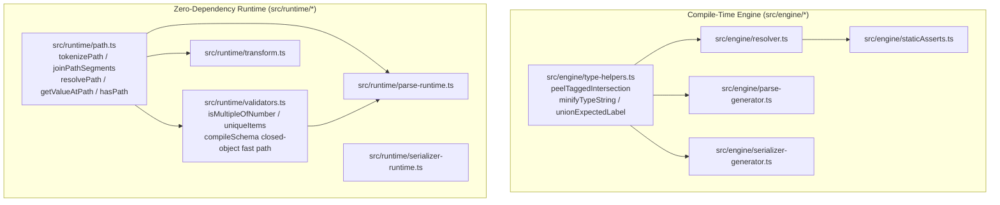
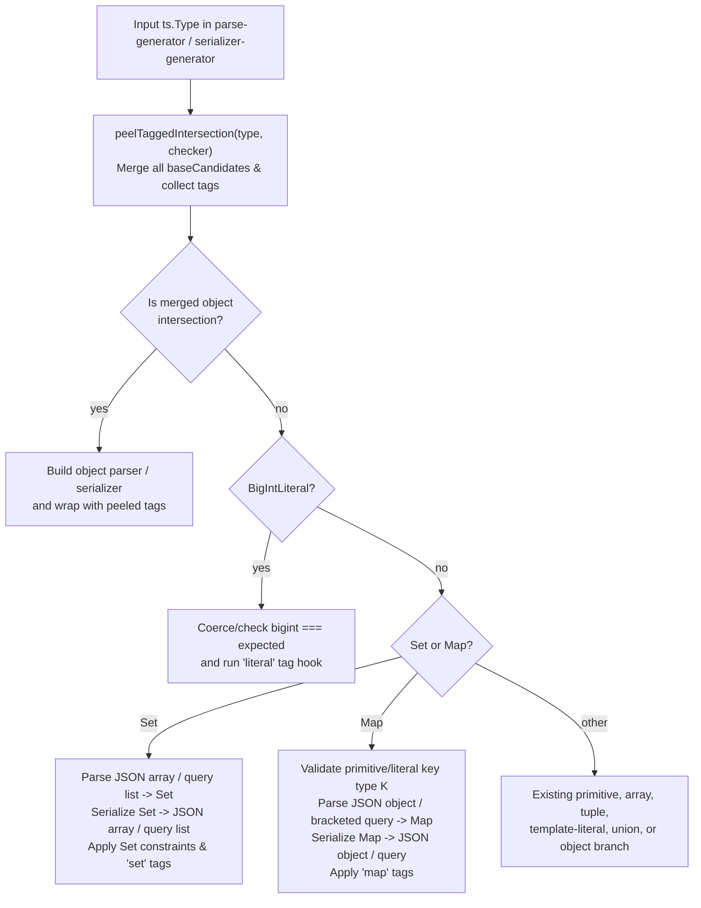
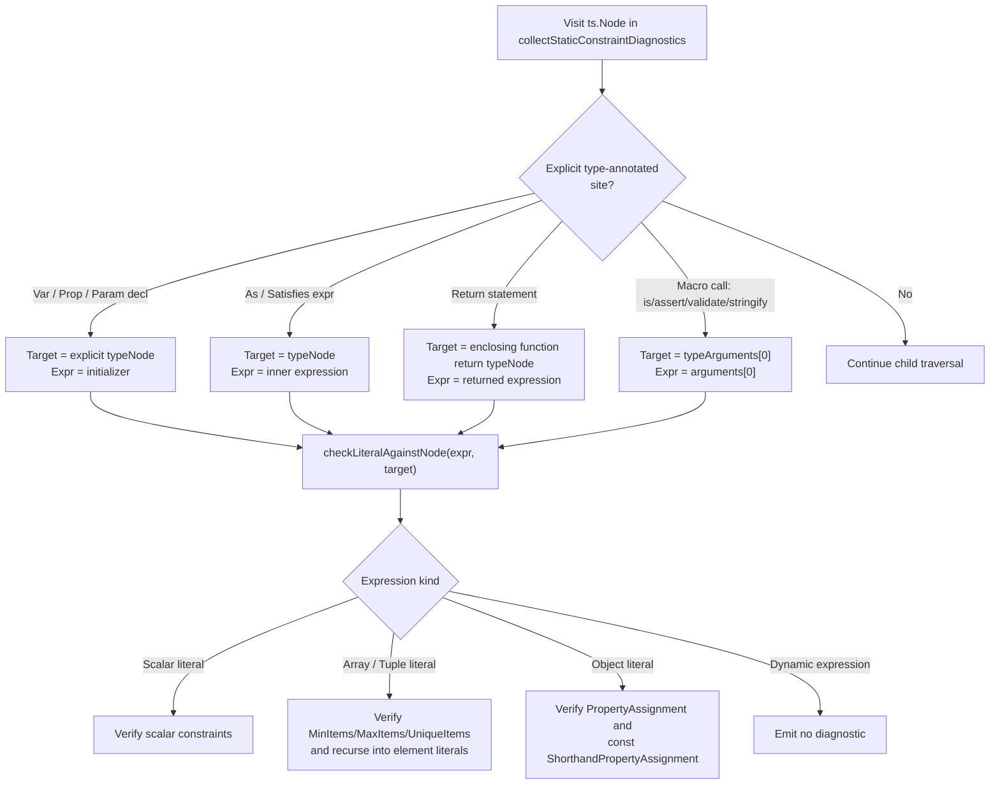

# Typechecker Hardening and Parity - Plan

## Goal Capsule

- **Objective:** Users of `@webergency-utils/typechecker` get identical type, constraint, and tag semantics across validation, parsing, serialization, and static editor diagnostics, with lower per-call overhead and zero regressions to existing public contracts.
- **Means:** Extend the existing AOT generators, runtime validators, transformer call visitor, and static AST analyzer in place while consolidating shared path and type-label utilities (KTD1, KTD2, KTD3, KTD4, KTD5, KTD6).
- **Product authority:** `## Product Contract` owns WHAT to build; `## Planning Contract` and `## Implementation Units` own HOW to build it within those requirements.
- **Execution profile:** Sequential or dependency-ordered unit execution (`U1` through `U8`) with per-unit verification and final repo-wide coverage gates.
- **Stop conditions:** Stop and surface a blocker if any change would break a locked behavioral contract in `tests/notes.md`, alter a public subpath export in `package.json`, or drop coverage below repo thresholds.
- **Tail ownership:** Executor runs `## Verification Contract` gates and satisfies `## Definition of Done` before handoff.
- **Open blockers:** None.

---

## Product Contract

**Product Contract preservation:** Product Contract unchanged.

### Summary

Bring `parse`, `stringify`/`createSerializer`, the AOT TypeScript transformer, and the language-service diagnostic plugin into full behavioral parity with `assert`/`validate`, while hoisting per-call allocations and deduplicating shared runtime and engine helpers. All existing public exports, validation modes, error formats, and runtime contracts remain unchanged.

### Problem Frame

`@webergency-utils/typechecker` provides three AOT macro families (`is`/`assert`/`validate`, `parse`/`createParser`, and `stringify`/`createSerializer`) alongside a TypeScript language-service plugin for static literal checking. Over successive feature additions, edge-case divergences accumulated between the older `validators` pipeline and the newer `parse`, `serializer`, and `staticAsserts` pipelines.

In the transformer, nested macro calls inside arguments of `is`, `assert`, `assertGuard`, and `validate` are not visited recursively, leaving inner macro calls unexpanded at runtime. In `parse` and `stringify`, `BigIntLiteral` types accept any `bigint` without verifying the literal value, `Set<T>` and `Map<K, V>` fall through to opaque objects or unsupported errors, and merged object intersections can drop `tag<...>` metadata or extra object arms when peeling tags. In `parse`, numeric and structural constraints (`MultipleOf`, `bigint` bounds, relative `Requires` paths, `UniqueItems`, template literal `${number}` and union slots, and extra-property copying) diverge from `assert`/`validate`. Finally, generated parsers and serializers allocate static `Set` and `RegExp` instances inside per-call closures, and path/type-formatting helpers are duplicated across runtime and engine modules.

### Key Decisions

- **Full `Set<T>` and `Map<K, V>` support in `parse` and `stringify`/`serializer`** `(session-settled: user-approved — chosen over compile-time rejection or parse-only support: keeps all AOT macro families consistent for JSON and query payloads)` — `Set<T>` round-trips as a JSON array or query list and `Map<K, V>` round-trips as a JSON object or bracketed query keys for primitive/literal keys. Governs R4, R5, R6.
- **Expanded static constraint diagnostics across explicit type-annotated sites** `(session-settled: user-approved — chosen over arbitrary function call inference or declaration-only checking: catches literal violations everywhere an explicit type contract is written without slowing down compilation)` — static diagnostics inspect declarations, explicit return types, `satisfies`/`as` assertions, AOT macro arguments, nested array/tuple literals, and `const` shorthand object properties. Governs R16, R17.
- **Preserve the parse-then-stringify round-trip when a custom `replacer` is supplied** — `stringify` and `createSerializer` must continue running `JSON.parse` before invoking a custom `replacer` so `Date` instances arrive as ISO strings matching native `JSON.stringify`. Governs R21.
- **Merge all object arms before applying intersection tags** — multi-arm object intersections combine every structural arm into a merged object base before applying outer `tag<...>` metadata so neither properties nor tags are lost. Governs R7, R8.
- **Consolidate duplicate runtime and engine helpers behind canonical modules** — shared path logic lives in `src/runtime/path.ts` and shared type-label helpers live in `src/engine/type-helpers.ts`, with existing subpath exports preserved via re-exports. Governs R19, R20, R21.

### Requirements

**Transformer and Macro Nesting**

- R1. The TypeScript transformer recursively visits all arguments passed to `is`, `assert`, `assertGuard`, `validate`, `parse`, and `stringify` before emitting the outer replacement expression so nested macro calls are expanded at compile time.
- R2. Calling `stringify<T>()` or `parse<T>()` with zero runtime arguments in transformed code fails gracefully without crashing the compiler or emitting invalid syntax.

**Literal, `Set<T>`, `Map<K, V>`, and Intersection Tag Parity**

- R3. `parse`, `createParser`, `stringify`, and `createSerializer` enforce exact value equality for `BigIntLiteral` types, rejecting mismatched values with `Literal<...n>` at the offending path while running any attached `'literal'` `bindTransformed` hook before serialization.
- R4. `parse` and `createParser` support `Set<T>` from JSON arrays and query list values and `Map<K, V>` from JSON plain objects and bracketed query keys, validating element, key, and value types and enforcing `MinItems`, `MaxItems`, and `UniqueItems` constraints on `Set<T>`.
- R5. `stringify` and `createSerializer` serialize `Set<T>` as JSON arrays or repeated query parameters and `Map<K, V>` as JSON objects or bracketed query keys, validating that the runtime value is an instance of `Set` or `Map` and executing any attached `tag<...>` hooks.
- R6. `Map<K, V>` in `parse` and `stringify`/`createSerializer` supports string, number, boolean, bigint, and corresponding literal key types by coercing keys to and from property strings, and rejects non-primitive key types at compile time.
- R7. `peelTaggedIntersection` merges all structural object candidates when an intersection contains multiple object arms alongside a `tag<...>` carrier so no object properties are dropped.
- R8. `stringify` and `createSerializer` preserve and execute outer `tag<...>` metadata on merged object intersections in both JSON and query modes.

**Constraint and Security Parity in `parse`**

- R9. `parse` and `createParser` evaluate `MultipleOf` using floating-point epsilon tolerance (`1e-8`) for numbers, exact modulo arithmetic for `bigint`, and reject a divisor of `0` or `0n`.
- R10. `parse` and `createParser` enforce `Min`, `Max`, `ExclusiveMin`, `ExclusiveMax`, and `MultipleOf` constraints on `bigint` values as well as `number` values without failing during AOT code generation when constraint arguments contain `bigint` values.
- R11. `parse` and `createParser` resolve `Requires` constraint paths against the root object using relative-to-current-path and root-path semantics matching `assert`/`validate`, treating keys with `undefined` values as missing.
- R12. `parse` and `createParser` evaluate `UniqueItems` using key-order-independent structural equality and `bigint`-safe hashing matching `assert`/`validate`.
- R13. Template literal type resolution and `parse` regex synthesis support negative and scientific-notation `${number}` placeholders and finite union placeholders.
- R14. `parse` and `createParser` copy retained extra properties in `relaxed` mode using own-property iteration and prototype-safe assignment so `__proto__`, `constructor`, and `prototype` keys cannot pollute `Object.prototype`.

**Performance and Allocation Hoisting**

- R15. Generated AOT parsers and serializers hoist static known-key `Set` instances and compiled `RegExp` patterns out of per-call functions, and `compileSchema` skips per-call `Object.keys` and `Set` allocations on closed objects when no pattern properties or unevaluated property tracking are active.

**Static Constraint Diagnostics**

- R16. Static constraint diagnostics validate literal arguments at explicit type-annotated sites: variable, property, and parameter declarations, explicit function `return` statements, `satisfies` and `as` expressions, and AOT macro calls (`assert<T>`, `validate<T>`, `is<T>`, `assertGuard<T>`, `stringify<T>`).
- R17. Static constraint diagnostics inspect array and tuple literal elements against array/tuple constraints and element types, and resolve `const` shorthand object properties (`{ x }`) when `x` is a local `const` literal or object/array literal.
- R18. Static constraint diagnostics skip non-literal dynamic expressions without emitting false-positive diagnostics.

**Internal Consolidation and Non-Regression**

- R19. Path tokenization, joining, relative path resolution, and path lookup helpers are consolidated in `src/runtime/path.ts` and shared by `validators.ts`, `parse-runtime.ts`, and `serializer-runtime.ts`.
- R20. Type-string minification and union expected-label formatting are consolidated in `src/engine/type-helpers.ts` and shared across all code generators.
- R21. All existing public package subpaths, `strict`/`relaxed`/`strip` validation mode rules, custom `replacer` round-trip behavior (`JSON.stringify(JSON.parse(out), replacer)`), error shapes, and test coverage gates continue to pass without regression.

### Acceptance Examples

- AE1. Nested macro call inside `validate` or `assert`
  - **Covers R1.**
  - **Given:** `const res = validate<Outer>(assert<Inner>(rawInput));` compiled with the TypeScript transformer.
  - **When:** The transformed code executes at runtime.
  - **Then:** Both the inner `assert<Inner>` and outer `validate<Outer>` calls are compiled into AOT validators rather than throwing a runtime uncompiled-macro error.

- AE2. `BigIntLiteral` mismatch in `parse` and `stringify`
  - **Covers R3.**
  - **Given:** Type `type Ten = 10n`.
  - **When:** `parse<Ten>('"11"')` or `stringify<Ten>(11n as unknown as Ten)` is called.
  - **Then:** `parse` throws a `ValidationError` and `stringify` throws a `SerializationError`, each reporting expected `Literal<10n>`.

- AE3. `Set<T>` and `Map<K, V>` round-trip in `parse` and `stringify`
  - **Covers R4, R5, R6.**
  - **Given:** `interface Payload { tags: Set<string>; scores: Map<string, number>; }`.
  - **When:** `stringify<Payload>({ tags: new Set(['a', 'b']), scores: new Map([['x', 1]]) })` is called and its JSON output is passed to `parse<Payload>()`.
  - **Then:** `stringify` emits `'{"tags":["a","b"],"scores":{"x":1}}'` and `parse` reconstructs a `Payload` whose `tags` is a `Set` containing `'a'` and `'b'` and whose `scores` is a `Map` with `'x' => 1`.

- AE4. Multi-arm tagged intersection in `stringify`
  - **Covers R7, R8.**
  - **Given:** `type Tagged = { a: string } & { b: number } & tag<{ transform: typeof enrich }>`.
  - **When:** `stringify<Tagged>(val, { transform: true })` is called.
  - **Then:** The `'object'` transform hook executes on the combined `{ a, b }` value and both `a` and `b` are serialized.

- AE5. `parse` constraint parity on `MultipleOf`, `Requires`, and `UniqueItems`
  - **Covers R9, R11, R12.**
  - **Given:** An object type with `price: number & MultipleOf<0.1>`, `discount: number & Requires<'../couponCode'>`, and `items: Array<{ id: number; name: string }> & UniqueItems`.
  - **When:** `parse` receives `'{"price":0.3,"discount":5,"couponCode":"SAVE","items":[{"id":1,"name":"a"},{"name":"a","id":1}]}'`.
  - **Then:** `price: 0.3` passes float-epsilon `MultipleOf<0.1>`, `discount` resolves `../couponCode` against the parent/root object, and `items` fails `UniqueItems` despite reversed key order.

- AE6. Static constraint diagnostics on macro calls, `satisfies`, and `const` shorthand
  - **Covers R16, R17, R18.**
  - **Given:** `type User = { age: number & Min<18>; tags: (string & MinLength<2>)[] & MinItems<1> }`.
  - **When:** Source code contains `const age = 15; const u = { age, tags: ['a'] } satisfies User;` or `assert<User>({ age: 15, tags: [] })`.
  - **Then:** The static analyzer reports diagnostics on `age`, `'a'`, and `tags` at their respective AST nodes while ignoring non-literal dynamic variables.

### Success Criteria

- Full existing and newly added unit test suites pass via `npm test`.
- Coverage gates via `npm run coverage` continue to meet or exceed repo thresholds: lines >= 98.5%, functions >= 99.5%, statements >= 97.5%, and branches >= 94%.
- Build via `npm run build` and typecheck via `npm run typecheck` complete with zero errors.

### Scope Boundaries

- Do not alter the locked `JSON.stringify(JSON.parse(out), replacer)` behavior in `src/transformer.ts` when a custom `replacer` is passed.
- Do not run `transform` tags inside `is<T>()` or `assertGuard<T>()`.
- Do not change validation mode semantics (`strict`, `relaxed`, `strip`) or coerce types when `from` is omitted in `assert`/`validate`.
- Do not support non-primitive object keys for `Map<K, V>` in JSON or query formats.

### Dependencies / Assumptions

- TypeScript `^6.0.2` compiler APIs used by `src/transformer.ts`, `src/plugin.ts`, and `src/engine/*` remain the sole compile-time dependency.
- All runtime modules remain zero-dependency and compatible with Node.js `>=20.0.0`.

### Sources / Research

- `tests/notes.md` — locked behavioral contracts, validation mode rules, custom `replacer` ISO-date contract, and coverage thresholds.
- `README.md` — documented public API surface, constraints, tags, and subpath exports.
- `src/transformer.ts` — macro call visitor and `VALIDATION_FUNCTIONS` argument traversal.
- `src/engine/parse-generator.ts` and `src/runtime/parse-runtime.ts` — AOT parser codegen and runtime constraint evaluation.
- `src/engine/serializer-generator.ts` and `src/runtime/serializer-runtime.ts` — AOT serializer codegen and runtime helpers.
- `src/engine/type-helpers.ts` and `src/engine/resolver.ts` — intersection tag peeling, template literal resolution, and type string helpers.
- `src/engine/staticAsserts.ts` and `src/plugin.ts` — static AST constraint diagnostics and language-service plugin integration.
- `src/runtime/validators.ts` and `src/runtime/path.ts` — canonical validation semantics, closed-object compilation, and path utilities.

---

## Planning Contract

### Key Technical Decisions

- KTD1. **Canonical runtime path module with backward-compatible re-exports** — Extend `src/runtime/path.ts` with `tokenizePath`, `joinPathSegments`, `isIndexSegment`, `resolvePath`, `getValueAtPath`, and `hasPath` so `src/runtime/validators.ts`, `src/runtime/transform.ts`, and `src/runtime/parse-runtime.ts` call one implementation while preserving existing exports. Governs R11, R19, R21.
- KTD2. **Shared runtime constraint helpers between `validators.ts` and `parse-runtime.ts`** — Export `isMultipleOfNumber` and the `uniqueItems` structural-equality / hashing check from `src/runtime/validators.ts` for direct reuse inside `src/runtime/parse-runtime.ts`, and emit `bigint` literals via a custom codegen serializer in `src/engine/parse-generator.ts` instead of `JSON.stringify`. Governs R9, R10, R12.
- KTD3. **Dedicated `Set<T>` and `Map<K, V>` codegen branches and runtime helpers** `(session-settled: user-approved — chosen over compile-time rejection or parse-only support: keeps all AOT macro families consistent for JSON and query payloads)` — Add `Set` and `Map` detection in `src/engine/parse-generator.ts` and `src/engine/serializer-generator.ts` before structural object fallback, delegating key/element coercion, tag hooks, and query bracket formatting to helpers in `src/runtime/parse-runtime.ts` and `src/runtime/serializer-runtime.ts`. Governs R4, R5, R6.
- KTD4. **Synthetic merged-object base in `peelTaggedIntersection` and pre-merge tag peeling in `serializer-generator.ts`** — When `peelTaggedIntersection` encounters multiple structural object arms, keep an intersection type of all base candidates so `mergeObjectIntersection` combines all properties while `serializer-generator.ts` peels outer tags before dispatching to `buildObjectSerializer` or `buildQueryObject`. Governs R7, R8.
- KTD5. **Enclosing-closure hoisting for static `Set` and `RegExp` allocations** — Emit static known-key `Set` (`__keys_<id>`) and `getCachedPattern` declarations in the outer factory scope of `generateParserCode` and `generateSerializerCode` rather than inside per-call functions, keeping inline transformed expressions self-contained. Governs R15.
- KTD6. **Single-pass AST visitor with local `const` binding resolution in `staticAsserts.ts`** `(session-settled: user-approved — chosen over arbitrary function call inference or declaration-only checking: catches literal violations everywhere an explicit type contract is written without slowing down compilation)` — Extend `collectStaticConstraintDiagnostics` to match declarations, explicit function return statements, `satisfies`/`as` assertions, and AOT macro calls, resolving shorthand object properties only when their symbol declaration is a `const` variable initialized to a literal or object/array literal. Governs R16, R17, R18.

### High-Level Technical Design

The diagrams below illustrate the shared helper topology across engine and runtime modules, the unified AOT parse/serialize type dispatch pipeline, and the static constraint diagnostic AST flow.

### System-Wide Impact

- **Subpath exports and public types:** `src/runtime/path.ts`, `src/runtime/validators.ts`, `src/runtime/parse-runtime.ts`, `src/runtime/serializer-runtime.ts`, and `src/index.ts` remain backward-compatible across all `package.json` exports (`@webergency-utils/typechecker`, `/runtime`, `/runtime/validators`, `/runtime/parse`, `/runtime/serialize`, `/runtime/path`).
- **AOT code generation:** `src/engine/parse-generator.ts` and `src/engine/serializer-generator.ts` emit hoisted helper bindings in their factory closures and reference new runtime helpers on `__tcRuntime` (`parseSet`, `parseMap`, `serializeSet`, `serializeMap`, `serializeQueryMap`, `setOwnProperty`).
- **Coverage gates:** `src/runtime/**`, `src/plugin.ts`, and `src/index.ts` are subject to strict Vitest coverage thresholds (`lines >= 98.5%`, `functions >= 99.5%`, `statements >= 97.5%`, `branches >= 94%`), requiring branch-complete tests for all new runtime helpers.

### Risks & Dependencies

| Risk | Impact | Mitigation |
|---|---|---|
| New runtime branches in `src/runtime/path.ts`, `src/runtime/parse-runtime.ts`, or `src/runtime/serializer-runtime.ts` lower branch coverage below 94% | Fails `npm run coverage` gate | Keep runtime helpers compact, reuse existing helpers from `src/runtime/validators.ts`, and add targeted branch tests in `tests/branch-coverage.test.ts` |
| `JSON.stringify` on constraint descriptors throws when a constraint contains a `BigInt` value | Compile-time crash in `parse<bigint & Minimum<10n>>()` | Replace `JSON.stringify(early)` in `src/engine/parse-generator.ts` with a custom descriptor emitter that formats `bigint` values as `10n` literals |
| Peeling tags on multi-arm intersections could alter single-arm tagged primitives | Regression in primitive `tag<...>` handling | Only synthesize an intersection base when `baseCandidates.length > 1`; keep single-candidate behavior identical |
| Static analyzer inspecting `const` shorthand properties could follow cyclic or mutable bindings | False positives or infinite recursion | Restrict shorthand resolution to `ts.VariableDeclaration` inside a `ts.VariableDeclarationList` with `ts.NodeFlags.Const` and bound recursion depth |

### Sequencing

1. **U1** consolidates runtime path utilities and engine type-string helpers first so downstream units build on the canonical helpers.
2. **U2** fixes transformer argument traversal and 0-argument macro call guards.
3. **U3** delivers `BigIntLiteral` validation and multi-arm tagged intersection fixes across `type-helpers.ts`, `parse-generator.ts`, and `serializer-generator.ts`.
4. **U4** adds `Set<T>` and `Map<K, V>` support across `parse` and `stringify`/`createSerializer`.
5. **U5** brings `parse` constraints (`MultipleOf`, `bigint` bounds, `Requires`, `UniqueItems`, template literals, and prototype-safe relaxed properties) into parity with `assert`/`validate`.
6. **U6** hoists static `Set` and `RegExp` allocations in `parse-generator.ts` and `serializer-generator.ts` and adds the closed-object fast path in `compileSchema`.
7. **U7** expands static constraint diagnostics in `src/engine/staticAsserts.ts` and `src/plugin.ts`.
8. **U8** runs the full parity, build, typecheck, and branch-coverage verification suite.

---

## Implementation Units

### U1. Consolidate Runtime Path and Engine Type-Label Helpers

- **Goal:** Deduplicate path manipulation utilities into `src/runtime/path.ts` and type-label formatting utilities into `src/engine/type-helpers.ts` without breaking existing imports.
- **Requirements:** R19, R20, R21, KTD1.
- **Dependencies:** None.
- **Files:**
  - `src/runtime/path.ts`
  - `src/runtime/validators.ts`
  - `src/runtime/transform.ts`
  - `src/runtime/parse-runtime.ts`
  - `src/engine/type-helpers.ts`
  - `src/engine/resolver.ts`
  - `src/engine/parse-generator.ts`
  - `src/engine/serializer-generator.ts`
  - `tests/validators.test.ts`
- **Approach:**
  1. Move `isIndexSegment`, `tokenizePath`, `joinPathSegments`, `resolvePath`, `getValueAtPath`, and `hasPath` into `src/runtime/path.ts`.
  2. Re-export `resolvePath`, `getValueAtPath`, and `hasPath` from `src/runtime/validators.ts` and `valueAtPath` from `src/runtime/transform.ts` so all internal and external callers remain compatible.
  3. Move `minifyTypeString` and `unionExpectedLabel` into `src/engine/type-helpers.ts` and import them in `src/engine/resolver.ts`, `src/engine/parse-generator.ts`, and `src/engine/serializer-generator.ts`.
- **Patterns to follow:** Follow `src/runtime/path.ts` zero-dependency helper style and `radixxko-format` rules.
- **Test scenarios:**
  - `tokenizePath`, `joinPathSegments`, `resolvePath`, `getValueAtPath`, and `hasPath` resolve root, nested dot, bracket index `items[0].id`, and relative `../sibling` paths identically across `validators` and `transform`.
  - Empty path `""`, root slash `"/"`, trailing dots, and out-of-bounds array index segments return `undefined` or `false` without throwing.
  - Calling `hasPath` on `null`, primitives, or objects where the target property exists with value `undefined` returns `false`.
- **Verification:** `npm run typecheck` and `npm test` pass with zero duplicate path or type-label helper definitions remaining in `validators.ts`, `transform.ts`, `resolver.ts`, `parse-generator.ts`, or `serializer-generator.ts`.

### U2. Recursive Argument Visiting and Zero-Argument Guards in Transformer

- **Goal:** Ensure nested AOT macro calls inside arguments of outer macro calls are transformed recursively and 0-argument `stringify`/`parse` calls are handled safely.
- **Requirements:** R1, R2, AE1.
- **Dependencies:** U1.
- **Files:**
  - `src/transformer.ts`
  - `tests/transformer.test.ts`
- **Approach:**
  1. In `src/transformer.ts`, pass `node.arguments[0]` and `node.arguments[1]` through `ts.visitNode` before constructing `valArg` and `optsArg` in the `VALIDATION_FUNCTIONS` branch, matching the `stringify` and `parse` branches.
  2. In the `stringify` and `parse` branches of `src/transformer.ts`, guard `node.arguments.length === 0` by passing an `undefined` identifier as the input argument instead of returning the uncompiled macro call node.
- **Patterns to follow:** Mirror the existing recursive argument visiting pattern in `src/transformer.ts`.
- **Test scenarios:**
  - Covers AE1. Nested `assert<Inner>` inside `validate<Outer>`, `is<Outer>` wrapping `parse<Inner>`, and `stringify<Outer>` wrapping `assert<Outer>` compile both inner and outer macros into AOT expressions and execute at runtime without throwing uncompiled-macro errors.
  - Three-level nested macro chains and macro calls passed inside the second options argument are recursively visited and transformed.
  - Zero-argument `parse<User>()` and `stringify<User>()` calls compile cleanly and fail at runtime with the expected validation or serialization error on `undefined`.
- **Verification:** `tests/transformer.test.ts` passes with nested macro and 0-argument test cases green.

### U3. `BigIntLiteral` Validation and Multi-Arm Tagged Intersection Handling

- **Goal:** Enforce `BigIntLiteral` value equality in `parse` and `stringify`/`createSerializer`, and preserve all object arms and outer `tag<...>` hooks on merged object intersections.
- **Requirements:** R3, R7, R8, AE2, AE4, KTD4.
- **Dependencies:** U1.
- **Files:**
  - `src/engine/type-helpers.ts`
  - `src/engine/parse-generator.ts`
  - `src/engine/serializer-generator.ts`
  - `tests/parse-fixes.test.ts`
  - `tests/serializer-fixes.test.ts`
- **Approach:**
  1. In `src/engine/parse-generator.ts`, separate `ts.TypeFlags.BigIntLiteral` from `ts.TypeFlags.BigInt` so `BigIntLiteral` coerces via `coerceBigInt`, compares the result against the literal `BigInt` value, and throws `ValidationError` with expected `'Literal<...n>'` on mismatch.
  2. In `src/engine/serializer-generator.ts` for both JSON and query builders, update the `ts.TypeFlags.BigIntLiteral` branch to apply `bindTransformed` for `'literal'`, verify `v === <val>n`, throw `SerializationError` on mismatch, and emit the literal string.
  3. In `src/engine/type-helpers.ts`, update `peelTaggedIntersection` so that when `baseCandidates.length > 1` and `type.isIntersection()` is true, `base` retains a synthesized or filtered intersection of all `baseCandidates` rather than dropping trailing candidates.
  4. In `src/engine/serializer-generator.ts` across `buildJsonSerializer` and `buildQuerySerializer`, peel tags via `peelTaggedIntersection` before checking `mergeObjectIntersection`, passing extracted tags into `buildObjectSerializer` and `buildQueryObject`.
- **Patterns to follow:** Match `BooleanLiteral`, `NumberLiteral`, and `StringLiteral` handling in `src/engine/parse-generator.ts` and `src/engine/serializer-generator.ts`.
- **Test scenarios:**
  - Covers AE2. `parse<10n>('"10"')` returns `10n` and `stringify<10n>(10n)` returns `'10'`, while `parse<10n>('"11"')` and `stringify<10n>(11n as any)` throw with expected `'Literal<10n>'`.
  - Covers AE4. `stringify<A & B & tag<{ transform: typeof fn }>>` and `parse<A & B & tag<{ validate: typeof fn }>>` preserve all properties from both `A` and `B` and invoke the attached tag hooks in both JSON and query modes.
  - Negative `BigIntLiteral` `-42n`, unions of `BigIntLiteral` values `1n | 2n`, and three-arm object intersections `A & B & C & tag<...>` round-trip and validate accurately.
- **Verification:** `tests/parse-fixes.test.ts` and `tests/serializer-fixes.test.ts` pass for all `BigIntLiteral` and multi-arm tagged intersection cases.

### U4. `Set<T>` and `Map<K, V>` Support in `parse` and `stringify`/`createSerializer`

- **Goal:** Add full JSON and query-string parsing and serialization for `Set<T>` and `Map<K, V>`, matching `assert`/`validate` (`from: 'json' | 'query'`) semantics.
- **Requirements:** R4, R5, R6, AE3, KTD3.
- **Dependencies:** U1, U3.
- **Files:**
  - `src/engine/resolver.ts`
  - `src/engine/parse-generator.ts`
  - `src/engine/serializer-generator.ts`
  - `src/runtime/parse-runtime.ts`
  - `src/runtime/serializer-runtime.ts`
  - `tests/parse-fixes.test.ts`
  - `tests/serializer-fixes.test.ts`
  - `tests/assert-parse-parity.test.ts`
- **Approach:**
  1. In `src/engine/parse-generator.ts` (and `src/engine/resolver.ts` `constrainedBaseKind`), detect `Set<T>` before structural object fallback, parse input as an array or query list, map elements through the element parser with indexed paths, enforce `MinItems`/`MaxItems`/`UniqueItems` constraints, construct `new Set`, and run any `'Set'` (`CoercionKind`) tag hooks.
  2. In `src/engine/parse-generator.ts` (and `src/engine/resolver.ts` `constrainedBaseKind`), detect `Map<K, V>`, verify at compile time that key type `K` is `string`, `number`, `boolean`, `bigint`, or a corresponding literal/union of primitives, parse input as a plain object or bracketed query map, coerce and validate each key and value, construct `new Map`, and run any `'Map'` (`CoercionKind`) tag hooks.
  3. In `src/engine/serializer-generator.ts`, detect `Set<T>` and `Map<K, V>` in both JSON and query builders, verify `v instanceof Set` or `v instanceof Map`, run `'Set'` or `'Map'` `bindTransformed` hooks, and serialize `Set<T>` as a JSON array or query list and `Map<K, V>` as a JSON object or bracketed query parameters.
- **Patterns to follow:** Match `validators.set` and `validators.map` in `src/runtime/validators.ts` for `'Set'` / `'Map'` `CoercionKind` tags, error paths, and expected labels.
- **Test scenarios:**
  - Covers AE3. JSON and query round-trip for `Set<string>`, `Set<number & Min<0>> & MinItems<1>`, `Map<string, number>`, `Map<number, boolean>`, and `Map<'a' | 'b', string>` in both `parse`/`createParser` and `stringify`/`createSerializer`.
  - Empty `Set` and `Map`, nested `Map<string, Set<number>>`, root-level `Map<string, string>` in query mode, and `Set`/`Map` with `tag<{ transform, validate }>` round-trip cleanly.
  - Passing a non-array for `Set<T>` or an array/primitive for `Map<K, V>` in `parse` throws `ValidationError` with expected `'Set'` or `'Map'`.
  - Passing a plain array or plain object to `stringify<Set<T>>` or `stringify<Map<K, V>>` throws `SerializationError`.
  - Invalid `Set` element or `Map` key/value throws at the exact element or entry path, and a non-primitive `Map` key type throws a compile-time error.
- **Verification:** `tests/parse-fixes.test.ts`, `tests/serializer-fixes.test.ts`, and `tests/assert-parse-parity.test.ts` pass for `Set` and `Map`.

### U5. `parse` Constraint, Template Literal, and Prototype-Safety Parity

- **Goal:** Align `parse` / `createParser` with `assert` / `validate` on `MultipleOf`, `bigint` constraints, `Requires`, `UniqueItems`, template literal `${number}`/unions, and prototype-safe extra-property copying.
- **Requirements:** R9, R10, R11, R12, R13, R14, AE5, KTD1, KTD2.
- **Dependencies:** U1.
- **Files:**
  - `src/engine/resolver.ts`
  - `src/engine/parse-generator.ts`
  - `src/runtime/validators.ts`
  - `src/runtime/parse-runtime.ts`
  - `tests/parse-fixes.test.ts`
  - `tests/assert-parse-parity.test.ts`
  - `tests/security-regressions.test.ts`
- **Approach:**
  1. Export `isMultipleOfNumber` and a reusable `hasUniqueItems` helper from `src/runtime/validators.ts` and call them inside `applyParseConstraints` in `src/runtime/parse-runtime.ts`.
  2. Update `applyParseConstraints` in `src/runtime/parse-runtime.ts` to support `typeof v === 'bigint'` alongside `typeof v === 'number'` for `minimum`, `maximum`, `exclusiveMinimum`, `exclusiveMaximum`, and `multipleOf`, and add a custom constraint-array emitter in `src/engine/parse-generator.ts` that formats `bigint` values as `${v}n` literals instead of calling `JSON.stringify`.
  3. Pass `root` into `applyParseConstraints` in `src/runtime/parse-runtime.ts` and `src/engine/parse-generator.ts`, resolving `requires` paths via `resolvePath(path, key)` and `hasPath`.
  4. In `src/engine/resolver.ts` and `src/engine/parse-generator.ts`, update the `${number}` template-literal regex fragment to support negative and scientific notation numbers and synthesize finite union/literal sub-type regex alternatives.
  5. In `src/engine/parse-generator.ts`, replace `for (const k in o)` extra-property copying in `relaxed` mode with `Object.keys(o)` iteration and prototype-safe own-property assignment via `setOwnProperty`.
- **Patterns to follow:** Reuse `isMultipleOfNumber`, `uniqueItems`, and `resolvePath`/`hasPath` semantics from `src/runtime/validators.ts`.
- **Test scenarios:**
  - Covers AE5. `parse` validates `number & MultipleOf<0.1>` on `0.3`, rejects `MultipleOf<0>`, validates `bigint & Minimum<10n> & MultipleOf<5n>`, resolves relative `Requires<'../sibling'>` and root `Requires<'/top.flag'>`, and detects duplicate objects with reordered keys in `UniqueItems`.
  - Template literals with negative or scientific numbers such as `` `val_${number}` `` on `'val_-1.5e2'` and union slots such as `` `prefix_${'a' | 'b'}_${1 | 2}` `` pass valid strings and reject non-matching strings.
  - Parsing `{"__proto__":{"polluted":true}}` in `relaxed` mode preserves the own property on the parsed result without polluting `Object.prototype`.
- **Verification:** `tests/parse-fixes.test.ts`, `tests/assert-parse-parity.test.ts`, and `tests/security-regressions.test.ts` pass.

### U6. Hoist Static Allocations in AOT Generators and Optimize `compileSchema` Closed Objects

- **Goal:** Eliminate per-call allocations of static known-key `Set`s and `RegExp` patterns in generated parsers and serializers, and skip redundant `Set`/`Object.keys` allocations for closed objects in `compileSchema`.
- **Requirements:** R15, KTD5.
- **Dependencies:** U3, U4, U5.
- **Files:**
  - `src/engine/parse-generator.ts`
  - `src/engine/serializer-generator.ts`
  - `src/runtime/validators.ts`
  - `tests/hoister.test.ts`
  - `tests/compile-schema.test.ts`
- **Approach:**
  1. Add a hoisted-declarations array to the generator context in `src/engine/parse-generator.ts` and `src/engine/serializer-generator.ts` so static `new Set` and `getCachedPattern` bindings are emitted once at the top of the outer factory closure rather than inside per-object or per-string functions.
  2. In `src/runtime/validators.ts` inside the `compileSchema` object branch, detect closed objects where `patternEntries.length === 0 && !hasUnevaluatedProps && additional === false`, hoist `knownKeySet = new Set(knownPropKeys)` outside the returned validator closure, and check unknown keys in a single `Object.keys(obj)` pass.
- **Patterns to follow:** Follow existing `__fn` declaration hoisting in `src/engine/parse-generator.ts` and `src/engine/serializer-generator.ts`.
- **Test scenarios:**
  - Generated parser and serializer code places `new Set` and `getCachedPattern` declarations in the outer closure outside `_fn0` and per-call functions.
  - `compileSchema` closed objects validate known properties and reject unknown properties identically to the general path, while schemas with `patternProperties`, `unevaluatedProperties`, or `additionalProperties: Validator` continue to use the full evaluation path.
  - Unknown keys on closed `compileSchema` objects report `unexpectedProperty` at the exact key path in both fail-fast and `collectErrors` modes.
- **Verification:** `tests/hoister.test.ts` and `tests/compile-schema.test.ts` pass.

### U7. Expand Static Constraint Diagnostics in `staticAsserts.ts` and `plugin.ts`

- **Goal:** Extend static compile-time constraint diagnostics to cover explicit return types, `satisfies`/`as` assertions, AOT macro call arguments, array/tuple literal elements, and `const` shorthand object properties.
- **Requirements:** R16, R17, R18, AE6, KTD6.
- **Dependencies:** U1.
- **Files:**
  - `src/engine/staticAsserts.ts`
  - `src/plugin.ts`
  - `tests/staticAsserts.test.ts`
  - `tests/static-diagnostics-fixes.test.ts`
  - `tests/plugin.test.ts`
- **Approach:**
  1. In `src/engine/staticAsserts.ts`, extend `collectStaticConstraintDiagnostics` to inspect `AsExpression` and `SatisfiesExpression` nodes, `ReturnStatement` nodes inside functions with an explicit `returnType` node, and `CallExpression` nodes targeting `@webergency-utils/typechecker` macros (`is`, `assert`, `assertGuard`, `validate`, `stringify`) with an explicit type argument.
  2. In `checkLiteralAgainstNode`, add `ArrayLiteralExpression` handling that validates `MinItems`, `MaxItems`, and `UniqueItems` on the array literal and recursively checks each literal element against the element or tuple-slot `TypeNode`.
  3. In `checkObjectLiteral`, support `ShorthandPropertyAssignment` by resolving its value symbol via `checker.getShorthandAssignmentValueSymbol`: when its declaration is a `const` `VariableDeclaration` with a literal initializer, validate that initializer and anchor any diagnostic at the shorthand property node.
- **Patterns to follow:** Preserve existing diagnostic code `99001`, category `ts.DiagnosticCategory.Error`, source `'typechecker'`, and message formatting in `src/engine/staticAsserts.ts`.
- **Test scenarios:**
  - Covers AE6. Static diagnostics fire on invalid literals in `satisfies User`, `as User`, explicit function `return { ... }`, `assert<User>({ ... })`, `validate<User>({ ... })`, `stringify<User>({ ... })`, array/tuple element literals, and `const` shorthand object properties.
  - Parenthesized expressions, `as const` assertions wrapped inside `satisfies`, tuple per-index constraints, and nested array-of-objects literals are accurately checked.
  - Mutable `let`/`var` shorthand bindings, function call results, and dynamic variables produce zero false-positive diagnostics.
- **Verification:** `tests/staticAsserts.test.ts`, `tests/static-diagnostics-fixes.test.ts`, and `tests/plugin.test.ts` pass.

### U8. End-to-End Parity, Build, and Coverage Verification

- **Goal:** Verify full behavioral parity, package build integrity, and coverage gate compliance across all modified modules.
- **Requirements:** R21.
- **Dependencies:** U1, U2, U3, U4, U5, U6, U7.
- **Files:**
  - `tests/assert-parse-parity.test.ts`
  - `tests/branch-coverage.test.ts`
- **Approach:**
  1. Add cross-macro parity test cases in `tests/assert-parse-parity.test.ts` covering `Set<T>`, `Map<K, V>`, `BigIntLiteral`, `MultipleOf` floats and bigints, relative `Requires`, and `UniqueItems`.
  2. Inspect branch coverage across `src/runtime/**`, `src/plugin.ts`, and `src/index.ts` via `npm run coverage` and add targeted edge-case tests in `tests/branch-coverage.test.ts` for any uncovered branches introduced in U1–U7.
- **Patterns to follow:** Follow the parity harness structure in `tests/assert-parse-parity.test.ts` and branch tests in `tests/branch-coverage.test.ts`.
- **Test scenarios:**
  - `npm run typecheck`, `npm test`, `npm run coverage`, and `npm run build` succeed cleanly.
  - Built ESM/CJS output in `tests/esm-cjs-built.test.ts` passes against compiled `dist/` artifacts.
- **Verification:** All verification contract commands exit `0` and all coverage metrics exceed required thresholds.

---

## Verification Contract

| Check | Command | Applies To | Done Signal |
|---|---|---|---|
| Typecheck | `npm run typecheck` | U1–U8 | Exits `0` with zero TypeScript errors |
| Unit & Parity Tests | `npm test` | U1–U8 | All test files pass with zero failures |
| Coverage Gate | `npm run coverage` | U1–U8 | Exits `0` with lines >= 98.5%, functions >= 99.5%, statements >= 97.5%, branches >= 94% |
| Package Build | `npm run build` | U8 | Exits `0` and generates clean `dist/` ESM, CJS, and `.d.ts` outputs |

---

## Definition of Done

- Every requirement `R1`–`R21` and acceptance example `AE1`–`AE6` is implemented and covered by passing automated tests in `tests/`.
- All Key Technical Decisions `KTD1`–`KTD6` are reflected in the implementation without violating `tests/notes.md` contracts or `radixxko-format` code style rules.
- `npm run typecheck`, `npm test`, `npm run coverage`, and `npm run build` all pass with zero errors.
- Any temporary scratch files, debug logs, or abandoned experimental code created during implementation are removed from the working tree before completion.
