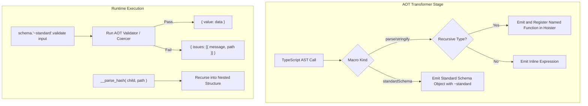

# Typechecker Advanced Capabilities and Parity - Plan

## Goal Capsule

- **Objective:** Add recursive type handling in `parse` and `stringify`, O(1) discriminated union dispatch in `parse` and `stringify`, Standard Schema v1 (`~standard`) interface compliance, and explicit custom message overrides on `Tag` type wrappers, without breaking any existing public contracts or performance characteristics.
- **Means:** Extend the AOT parser generator (`src/engine/parse-generator.ts`), serializer generator (`src/engine/serializer-generator.ts`), AST hoister (`src/engine/hoister.ts`), transformer call visitor (`src/transformer.ts`), and runtime validators/tags in place with comprehensive unit tests and zero external runtime dependencies.
- **Product authority:** `## Product Contract` owns WHAT to build; `## Planning Contract` and `## Implementation Units` own HOW to build it within those requirements.
- **Execution profile:** Sequential implementation units (`U1` through `U4`) ordered by dependency, followed by full repo verification (`U5`).
- **Stop conditions:** Stop and surface a blocker if any change causes a breaking change in existing exports, drops branch coverage below 94.0% or statement coverage below 97.5%, or introduces an external runtime dependency.
- **Tail ownership:** Executor verifies test suites, linter, typecheck, and coverage gates before handoff.
- **Open blockers:** None.

---

## Product Contract

### Summary
Add recursive type support to `parse` and `stringify`, O(1) discriminated union dispatch to `parse` and `stringify`, Standard Schema v1 specification compliance via a zero-dependency `~standard` interface, and a custom message tag override `Tag<T, Constraint, Value, Message>`.

### Problem Frame
`@webergency-utils/typechecker` provides compile-time AOT code generation for TypeScript validation, parsing, and serialization. Currently:
1. `assert`, `is`, and `validate` support recursive types via hoisted `__val_<hash>` functions, but `parse` and `stringify` throw compile-time errors when encountering recursive/cyclic types.
2. `parse` and `stringify` already have tagged-union detection in their core passes, but need unified handling for both JSON and query modes and complete test coverage with deep nested branches.
3. Modern TypeScript libraries (tRPC, Hono, TanStack Form, Next.js) consume schemas implementing the Standard Schema v1 specification (`~standard`). Supporting this enables zero-glue adoption of `@webergency-utils/typechecker`.
4. While `src/runtime/tags/constraint.ts` supports custom error messages on specific constraint types (e.g., `MinLength<N, Msg>`), users need an explicit generic message override tag (`Tag<T, Constraint, Value, Message>` and `Message<Msg>`) that applies cleanly across validation and parsing.

### Requirements

- R1. `parse<T>( input )` and `stringify<T>( input )` / `serializer<T>()` must support self-referential / recursive types (e.g. tree structures, linked lists, recursive menus) by generating and hoisting named recursive functions (`__parse_<hash>` and `__ser_<hash>`) rather than throwing codegen errors.
- R2. `parse<T>` and `stringify<T>` must emit O(1) `switch` dispatch based on literal discriminant keys across object union arms in both JSON and query formats, falling back to sequential union evaluation only when no unique literal discriminant exists.
- R3. Expose Standard Schema v1 (`~standard`) compatibility via a callable standard schema object returned by `standardSchema<T>()` macro and/or `compileSchema()` output, adhering strictly to the `@standard-schema/spec` v1 contract without runtime dependencies.
- R4. Support an explicit `Tag<T, Constraint, Value, Message>` type helper and ensure `Message<Msg>` overrides default error messages in `ValidationError` during validation and parsing.

### Scope Boundaries

#### In Scope
- Codegen updates in `src/engine/parse-generator.ts`, `src/engine/serializer-generator.ts`, `src/engine/hoister.ts`, and `src/transformer.ts`.
- Runtime support and types in `src/runtime/parse-runtime.ts`, `src/runtime/serializer-runtime.ts`, `src/runtime/tags/tag.ts`, `src/runtime/tags/constraint.ts`, and `src/index.ts`.
- Comprehensive test coverage for recursive structures, tagged unions, Standard Schema spec compliance, and custom error messages.

#### Deferred to Follow-Up Work
- Streaming parser / serializer support for multi-gigabyte JSON payloads.
- Automated code-fix LSP suggestions for type mismatches.

### Key Decisions
- KD1. `(session-settled: user-directed — chosen over separate branch):` Implement all next-horizon features directly on the active branch `feat/typechecker-hardening-and-parity`.
- KD2. `(session-settled: user-directed — chosen over external dependency):` Implement Standard Schema v1 using zero external runtime dependencies by inlining the TypeScript interface types and runtime shape conforming to `@standard-schema/spec` v1. Governs R3.

---

## Planning Contract

### Key Technical Decisions

- KTD1. **Recursive Hoisting in Transformer and Generator (Governs R1):** When `visiting.has( typeId )` is detected during recursive traversal in `parse-generator.ts` or `serializer-generator.ts`, emit a call to `__parse_<hash>( ... )` or `__ser_<hash>( ... )`. The top-level generator wraps the entrypoint as a function declaration or expression and registers it into `parserCache` / `serializerCache` so `hoister.ts` emits it at module scope with parameter names `( v, p )` / `( val, path )`.
- KTD2. **Discriminated Union O(1) Dispatch (Governs R2):** Standardize tagged union emission using `tryTaggedUnionTypes` across `parse-generator.ts` and `serializer-generator.ts` (JSON and Query serializers). Ensure string, number, and boolean discriminant literals are properly formatted in `case` labels.
- KTD3. **Standard Schema v1 Interface (Governs R3):** Add `standardSchema<T>( options? )` AOT macro that emits an object implementing `{ '~standard': { version: 1, vendor: '@webergency-utils/typechecker', validate: ( value ) => ... } }`. If valid, it returns `{ value: coerced }`; if invalid, it returns `{ issues: [{ message, path }] }`. Synchronous validation avoids Promise overhead.
- KTD4. **Custom Message Resolution (Governs R4):** Add `Tag<T, Constraint, Value, Message>` helper in `src/runtime/tags/tag.ts`. Ensure parser and validator constraint processors pick up `__message` and constraint-specific `__*_message` fields and format them with `{path}` and `{value}` replacements.

### High-Level Technical Design



---

## Implementation Units

### U1. Recursive Type Support in Parse and Serializer
**Goal:** Enable parsing and serialization of recursive data structures (e.g. nested categories, trees, linked nodes) without compilation errors.
**Requirements:** R1
**Dependencies:** None
**Files:**
- `src/engine/parse-generator.ts`
- `src/engine/serializer-generator.ts`
- `src/engine/hoister.ts`
- `src/transformer.ts`
- `tests/recursive-parse-serializer.test.ts`
**Approach:**
1. In `src/engine/parse-generator.ts`, track visiting types. When recursion is detected (`visited.has( typeId )`), generate a recursive call `__parse_${resolvedHash}( ${varName}, ${pathExpr} )` instead of throwing an error.
2. In `src/engine/serializer-generator.ts`, similarly generate `__ser_${resolvedHash}( ${varName}, ${pathExpr} )` when recursion is detected.
3. Ensure the generator creates a top-level function `function __parse_${hash}( v, p ) { ... }` / `function __ser_${hash}( val, path ) { ... }` that can call itself.
4. Update `hoister.ts` to hoist function declarations or expressions cleanly to file scope.
**Test Scenarios:**
- Happy path: Parse a JSON tree structure `interface TreeNode { val: string; children?: TreeNode[] }` with multiple nesting levels.
- Happy path: Stringify a recursive tree structure with nested children to JSON.
- Edge case: Recursive structure with cyclic object reference at runtime throws expected depth or circularity protection error during parse/stringify.
- Error path: Malformed child node deep in recursive hierarchy returns exact path in `ParseError` / `SerializationError`.
**Verification:**
`npx vitest run tests/recursive-parse-serializer.test.ts` passes with 100% assertions satisfied.

---

### U2. Discriminated Union O(1) Dispatch Hardening
**Goal:** Guarantee O(1) `switch` dispatch across all union formats in `parse` and `stringify` with comprehensive branch coverage.
**Requirements:** R2
**Dependencies:** None
**Files:**
- `src/engine/parse-generator.ts`
- `src/engine/serializer-generator.ts`
- `tests/discriminated-unions.test.ts`
**Approach:**
1. Audit `parse-generator.ts` and `serializer-generator.ts` tagged-union branches. Ensure `tryTaggedUnionTypes` supports string, number, and boolean discriminant literals.
2. Ensure both JSON serializer and Query serializer emit optimal switch statements when tagged unions are present.
3. Add full unit testing asserting that switch dispatch executes in O(1) without iterating subsequent union arms.
**Test Scenarios:**
- Happy path: Parse discriminated union with 5 distinct `kind` tags in JSON mode.
- Happy path: Parse discriminated union in query mode with URL-encoded parameters.
- Happy path: Serialize discriminated union to JSON string.
- Happy path: Serialize discriminated union to query string.
- Error path: Invalid discriminant value throws `ParseError` / `SerializationError` with expected union label.
**Verification:**
`npx vitest run tests/discriminated-unions.test.ts` passes.

---

### U3. Standard Schema v1 (~standard) Compliance
**Goal:** Implement the `@standard-schema/spec` v1 specification natively without external dependencies.
**Requirements:** R3, KD2
**Dependencies:** None
**Files:**
- `src/index.ts`
- `src/transformer.ts`
- `src/runtime/validators.ts`
- `tests/standard-schema.test.ts`
**Approach:**
1. Define `StandardSchemaV1` TypeScript interface in `src/runtime/validators.ts` or `src/index.ts` matching the official `@standard-schema/spec` specification:
   - `~standard: { version: 1, vendor: '@webergency-utils/typechecker', validate: ( value: unknown ) => StandardResult<T> }`
2. Add macro `standardSchema<T>( options? )` in `src/index.ts` and implement transformer rewrite in `src/transformer.ts`.
3. In `compileSchema( schema )`, attach `~standard` to the compiled validator function so compiled JSON schemas also adhere to Standard Schema v1.
4. Convert `ValidationError` issues to `{ message: string, path?: PropertyKey[] }` in `issues`.
**Test Scenarios:**
- Happy path: `standardSchema<T>()` returns object with `~standard.version === 1` and `vendor === '@webergency-utils/typechecker'`.
- Happy path: Calling `schema['~standard'].validate( validData )` returns `{ value: validData }` synchronously.
- Error path: Calling `schema['~standard'].validate( invalidData )` returns `{ issues: [...] }` with exact paths and messages.
- Integration: Pass standard schema into a mock validator consumer expecting `@standard-schema/spec`.
**Verification:**
`npx vitest run tests/standard-schema.test.ts` passes.

---

### U4. Custom Error Message Support on Tag Types
**Goal:** Provide an explicit `Tag<T, Constraint, Value, Message>` type helper and ensure custom messages override standard validation and parsing errors.
**Requirements:** R4
**Dependencies:** None
**Files:**
- `src/runtime/tags/tag.ts`
- `src/runtime/tags/constraint.ts`
- `src/runtime/tags.ts`
- `src/engine/resolver.ts`
- `src/engine/parse-generator.ts`
- `src/runtime/parse-runtime.ts`
- `tests/custom-messages.test.ts`
**Approach:**
1. In `src/runtime/tags/tag.ts`, update `tag.Tag` or create a unified `Tag<T, Constraint, Value, Msg extends string = string>` helper that produces the combined intersection metadata.
2. In `src/engine/resolver.ts` and `src/engine/parse-generator.ts`, inspect `__message` and tag-specific `__<constraint>_message` properties to pass custom message strings into generated validation checks.
3. In `src/runtime/parse-runtime.ts` and `src/runtime/validators.ts`, ensure `ValidationError` and `ParseError` respect custom messages and interpolate `{value}` and `{path}` placeholders when provided.
**Test Scenarios:**
- Happy path: Validation with `Tag<string, 'minLength', 5, 'Must be at least 5 chars'>` emits custom message on failure.
- Happy path: Custom message with placeholders `"{path} was invalid: {value}"` formats correctly on error.
- Happy path: `parse` with custom error message produces `ParseError` with the overridden message.
**Verification:**
`npx vitest run tests/custom-messages.test.ts` passes.

---

### U5. Full Regression, Coverage, and Documentation Verification
**Goal:** Verify all existing and new tests pass, repo coverage thresholds are satisfied, and README is updated.
**Requirements:** R1, R2, R3, R4
**Dependencies:** U1, U2, U3, U4
**Files:**
- `README.md`
- `tests/*`
**Approach:**
1. Run `npm run lint` and verify zero lint errors according to `radixxko-format`.
2. Run `npm run build` and verify clean TypeScript build.
3. Run `npm run coverage` and verify all coverage thresholds pass (Statements >= 97.5%, Branches >= 94.0%, Functions >= 99.5%, Lines >= 98.5%).
4. Update `README.md` to document the new features (`standardSchema`, recursive types, custom messages).
**Verification:**
`npm run build && npm run lint && npm run coverage` exits with code 0.

---

## Verification Contract

```bash
npm run build
npm run lint
npm run coverage
```

Gates:
- All 41+ test suites passing.
- Statements >= 97.5%
- Branches >= 94.0%
- Functions >= 99.5%
- Lines >= 98.5%

---

## Definition of Done

1. All units U1 through U5 are implemented and verified.
2. Zero breaking changes to existing public exports in `src/index.ts`.
3. Code strictly conforms to `radixxko-format` (Allman braces, 4 spaces, spaces inside parens).
4. Documentation in `README.md` accurately reflects new capabilities.
