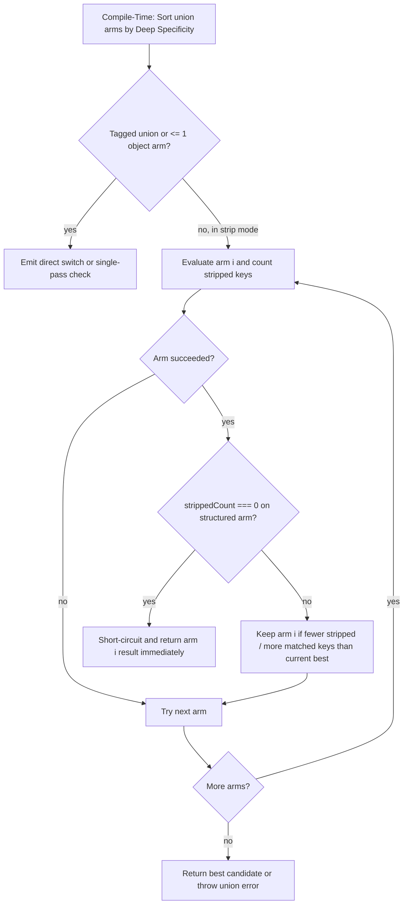
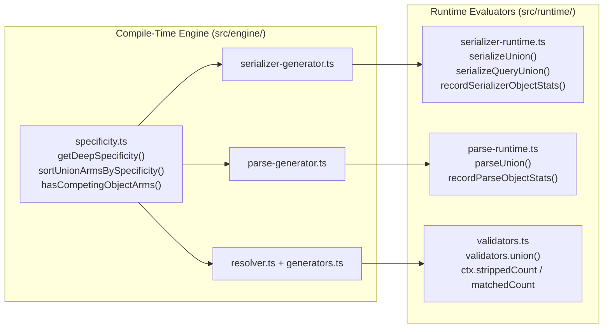

# Lossless Union Resolution and Deep Specificity - Plan

## Goal Capsule

- **Objective:** Ensure untagged union serialization, parsing, and strip-mode validation automatically select the union branch that preserves all declared properties present on the input without dropping fields to a narrower or earlier branch.
- **Means:** Extract a shared compile-time deep structural specificity scorer in `src/engine/specificity.ts` for serializer, parser, and validator codegen, and pair it with single-pass runtime short-circuiting best-fit selection in `'strip'` mode across the runtime union helpers.
- **Product authority:** `## Product Contract` owns WHAT to build; `## Planning Contract` and `## Implementation Units` own HOW to build it within those requirements.
- **Execution profile:** Sequential implementation units (`U1` through `U4`) ordered by dependency, followed by full regression, coverage, and documentation verification (`U5`).
- **Stop conditions:** Stop and surface a blocker if any change breaks existing public exports, alters discriminated union O(1) switch dispatch semantics, or drops test coverage below repository thresholds.
- **Tail ownership:** Executor verifies build, lint, unit tests, and coverage gates before handoff.
- **Open blockers:** None.

---

## Product Contract

- **Product Contract preservation:** Product Contract unchanged.

### Summary

Untagged unions across serialization, parsing, and strip-mode validation will sort branches at compile time by deep structural specificity and select the best-fitting branch at runtime in a single pass. Any structured branch that matches with zero stripped properties short-circuits immediately, while inputs containing extra unknown properties fall back to the valid branch that strips the fewest keys.

### Problem Frame

Currently, `src/engine/serializer-generator.ts` ranks union branches using a shallow property count where required and optional properties carry equal weight and nested object shapes are ignored. In `src/engine/parse-generator.ts` and `src/engine/resolver.ts`, untagged union branches are not sorted by specificity at all and run in declaration order.

When evaluating untagged unions in default `'strip'` mode, two failure modes cause silent data loss:
1. Compile-time ordering skew: a branch with more optional properties or a shallower structure runs ahead of a branch with more required or deeply nested properties, succeeds on shared fields, and strips the remaining declared fields.
2. Runtime overlap on disjoint optional or nested union branches: when two branches have disjoint optional fields or a nested union mixes narrow and wide arms, no static ordering prevents the first branch from stripping fields that a later branch would have accepted, especially when the input also carries an unrelated extra property.

### Key Decisions

- **Unified short-circuiting best-fit with deep specificity** `(session-settled: user-approved — chosen over two-pass strict-first or compile-time-only sorting: short-circuits on clean inputs in one pass while preserving declared union fields even when extra unknown keys are present)`. Governs R1, R6, R7, R8.
- **95% per-level depth decay (`0.95`)** `(session-settled: user-approved — chosen over 5% per-level decay: preserves nested property weight so deeper fields outweigh a single top-level field while breaking ties toward shallower depth)`. Governs R2.
- **`min + ε · max` scoring for nested unions** `(session-settled: user-approved — chosen over pure max or average: prevents a union with a narrow arm and a wide arm from jumping ahead of a medium sibling and stripping its fields)`. Governs R3.
- **Full parity across serializer, parser, and strip-mode validators** `(session-settled: user-approved — chosen over serializer-only or serializer-and-parser-only: guarantees identical union branch selection across all three pipelines)`. Governs R1, R6, R7.
- **Bare `object` as fallback after structured branches in `'strip'` mode** `(session-settled: user-approved — chosen over treating bare object as a zero-strip match: preserves field-level Date, BigInt, and transform rules on structured branches whose required fields match)`. Governs R4, R9.
- **Fast-path preservation for discriminated and non-competing unions**: unions resolved via literal discriminants or containing at most one structured object branch bypass runtime strip-counting overhead. Governs R10.
- **Mode scoping to `'strip'` mode**: runtime best-fit selection runs only in `'strip'` mode because `'strict'` mode already rejects undeclared keys and `'relaxed'` mode retains all extra keys using compile-time specificity order. Governs R6, R11.

### Requirements



**Compile-Time Deep Specificity Ordering**

- R1. Untagged union branches in `serializer`/`stringify`, `parse`, and `validate`/`is`/`assert` must be sorted in descending order of deep structural specificity at compile time across both JSON and query formats.
- R2. Deep structural specificity must weight required properties above literal types and optional properties, applying a `0.95` multiplier per nesting level while adding the root object category offset only at depth zero.
- R3. When scoring a nested union at compile time, the scorer must compute `min + 0.001 * max` across its non-nullish branches so the minimum required shape governs ordering while the widest branch breaks ties.
- R4. Compile-time specificity must rank structured object branches with declared properties above string-index-signature-only `Record<string, V>` objects, which in turn rank above empty `{}` objects and bare `object` (`TypeFlags.NonPrimitive`).
- R5. Compile-time specificity scoring must track visited type IDs and enforce a maximum recursion depth so cyclic or recursive types terminate deterministically with zero contribution on back-edges.

**Runtime Short-Circuiting Best-Fit in `'strip'` Mode**

- R6. When evaluating an untagged union with two or more competing object branches in `'strip'` mode, `serializer`/`stringify`, `parse`, and `validate`/`assert` must track how many runtime properties are stripped and how many declared properties are matched across the branch and its nested objects.
- R7. When a structured object branch succeeds in `'strip'` mode with zero stripped properties (`strippedCount === 0`), union evaluation must short-circuit and return that branch's result without evaluating subsequent branches.
- R8. When a structured object branch succeeds in `'strip'` mode with one or more stripped properties (`strippedCount > 0`), union evaluation must continue checking remaining branches and select the valid branch with the fewest stripped properties, breaking ties by matched declared property count and then compile-time specificity order.
- R9. Bare `object` (`TypeFlags.NonPrimitive`) branches in `'strip'` mode must be selected only when no structured object branch in the union succeeds, ensuring structured branches apply their property-level serialization, coercion, and transform rules.
- R10. Discriminated unions handled by O(1) tag dispatch and unions containing at most one structured object branch must bypass runtime best-fit tracking and use direct dispatch or single-pass evaluation.
- R11. Union evaluation in `'strict'` and `'relaxed'` modes must use single-pass evaluation in compile-time deep specificity order without runtime stripped-key tracking.

### Acceptance Examples

- AE1. Subtype union ordering (`A | B | C`)
  - **Covers R1, R7.**
  - **Given:** `type A = { foo: string }`, `type B = { bar: number }`, `type C = { foo: string; bar: number }`, and `type Result = A | B | C` in `'strip'` mode.
  - **When:** `stringify<Result>({ foo: "hi", bar: 42 })` or `parse<Result>('{"foo":"hi","bar":42}')` is called.
  - **Then:** `C` is evaluated first, matches with `strippedCount === 0`, short-circuits immediately, and preserves both `foo` and `bar`.

- AE2. Required properties outweigh optional properties
  - **Covers R1, R2, R7.**
  - **Given:** `type A = { foo: string; opt1?: number; opt2?: number }` and `type C = { foo: string; bar: number }` in `type Result = A | C`.
  - **When:** `{ foo: "hi", bar: 42 }` is serialized, parsed, or validated in `'strip'` mode.
  - **Then:** `C` ranks higher than `A` at compile time, runs first, short-circuits with `strippedCount === 0`, and preserves `bar`.

- AE3. Disjoint optional properties with extra unknown key
  - **Covers R6, R8.**
  - **Given:** `type A = { id: string; a1?: string; a2?: string }` and `type B = { id: string; b1?: string }` in `type Result = A | B`.
  - **When:** `{ id: "1", b1: "keep", extra: "drop" }` is serialized, parsed, or validated in `'strip'` mode.
  - **Then:** `A` strips two keys while `B` strips only `extra`, so `B` is selected and returns `{ id: "1", b1: "keep" }`.

- AE4. Nested union straddling a medium sibling
  - **Covers R3, R6, R7, R8.**
  - **Given:** `Small = { id: string }`, `Medium = { id: string; a: number; b: number }`, `Huge = { id: string; a: number; b: number; c: number; d: number }`, and `type Result = { data: Small | Huge } | { data: Medium }`.
  - **When:** `{ data: { id: "1", a: 1, b: 2 } }` or `{ data: { id: "1", a: 1, b: 2, c: 3, d: 4 } }` is processed in `'strip'` mode.
  - **Then:** `{ data: Medium }` is selected for the 3-key input with zero stripped keys, and `{ data: Huge }` is selected for the 5-key input with zero stripped keys.

- AE5. Structured branch with `object` fallback
  - **Covers R4, R9, R11.**
  - **Given:** `type A = { foo: string }` and `type Result = A | object`.
  - **When:** `{ foo: "hi", extra: 1 }` is processed in `'strip'` mode versus `'strict'` mode.
  - **Then:** In `'strip'` mode, `A` succeeds and strips `extra` to produce `{"foo":"hi"}`; in `'strict'` mode, `A` fails on `extra` and falls through to `object` to produce `{"foo":"hi","extra":1}`; for `{ other: 1 }`, `A` fails in both modes and falls through to `object`.

### Scope Boundaries

- Reordering `anyOf` branches in `jsonSchema<T>()` output is out of scope because JSON Schema validation does not strip properties or depend on branch evaluation order.
- Runtime best-fit tracking for unions in `'relaxed'` mode is out of scope; `'relaxed'` mode retains undeclared keys on the first matching branch in deep specificity order.

### Sources / Research

- `src/engine/serializer-generator.ts` — shallow `getObjectSpecificity` at lines 63-130, JSON union codegen at lines 439-460, and query union codegen at lines 769-789.
- `src/runtime/serializer-runtime.ts` — single-pass `serializeUnion` at lines 187-217.
- `src/engine/parse-generator.ts` — untagged union codegen at lines 748-791, which currently preserves declaration order.
- `src/runtime/parse-runtime.ts` — single-pass `parseUnion` at lines 74-104.
- `src/engine/resolver.ts` — validator union codegen at lines 309-337.
- `src/runtime/validators.ts` — `validators.union` implementation at lines 2024-2085.

---

## Planning Contract

### System-Wide Impact

- **Interaction graph:** `src/engine/specificity.ts` is consumed at compile time by `src/engine/serializer-generator.ts`, `src/engine/parse-generator.ts`, and `src/engine/resolver.ts`. At runtime, generated union code delegates to `__tcRuntime.serializeUnion` and `__tcRuntime.serializeQueryUnion` in `src/runtime/serializer-runtime.ts`, `__tcRuntime.parseUnion` in `src/runtime/parse-runtime.ts`, and `validators.union` in `src/runtime/validators.ts`.
- **Error & failure propagation:** When all union arms fail in `'strip'`, `'strict'`, or `'relaxed'` mode, error reporting remains unchanged. `serializeUnion` and `serializeQueryUnion` throw `SerializationError`, `parseUnion` throws `ParseError`, and `validators.union` aggregates `unionErrors` into `ctx.errors`.
- **State lifecycle risks:** Runtime strip-count probes in `src/runtime/serializer-runtime.ts` and `src/runtime/parse-runtime.ts` use a `try / finally` stack frame so nested unions and thrown exceptions never leak probe state across calls. In `src/runtime/validators.ts`, `subCtx` in `validators.union` runs with `mutate: false`, preventing speculative arms from mutating caller objects before `accept` commits the winning branch.
- **API surface parity:** Public macro signatures (`stringify`, `serializer`, `parse`, `is`, `assert`, `assertGuard`, `validate`) remain unchanged while achieving identical union arm resolution across JSON and query formats.

### Key Technical Decisions

- KTD1. **Dedicated Compile-Time Specificity Module (Governs R1, R2, R3, R4, R5):** Create `src/engine/specificity.ts` exporting `getDeepSpecificity`, `sortUnionArmsBySpecificity`, `isFallbackUnionArm`, and `hasCompetingObjectArms`. The scorer peels tagged intersections via `peelTaggedIntersection` and merges object intersections via `tryMergeObjectTypes` before computing weights. At depth zero, structured objects with declared properties start at `1000`, `Record<string, V>` starts at `500`, empty `{}` starts at `200`, bare `object` scores `100`, and primitives score `10`. Each required property adds `1.0 + 0.95 * childScore` while each optional property adds `0.25 * ( 1.0 + 0.95 * childScore )`, where `childScore` omits the root category offset so nested properties scale by `0.95` per level and required properties strictly outweigh pairs of optional properties. Literal types add `0.8`, template literals add `0.6`, and peeled constraint tags add `0.25` each. Cyclic types are guarded by a `visited` set that unwinds in `finally` plus a hard cap of `MAX_SPECIFICITY_DEPTH = 16`.
- KTD2. **Probe-Gated Strip and Match Counting in Serializers and Parsers (Governs R6, R7, R8, R10, R11):** Maintain a module-local probe stack in `src/runtime/serializer-runtime.ts` with `hasSerializerUnionProbe` and `recordSerializerObjectStats`, and in `src/runtime/parse-runtime.ts` with `hasParseUnionProbe` and `recordParseObjectStats`. Object serializers (`buildObjectSerializer`, `buildQueryObject`) and object parsers (`buildObjectValidation`) in `'strip'` mode count unknown keys only when a union probe is active on a competing union. Outside of competing `'strip'` unions, `'strip'` mode executes zero extra key-counting loops.
- KTD3. **Fallback Mask for Unconstrained Arms in Runtime Union Helpers (Governs R4, R8, R9):** Pass an optional `fallbackFlags` boolean array into `serializeUnion`, `serializeQueryUnion`, `parseUnion`, and `validators.union` when any arm in a competing union is a bare `object`, `any`, or `unknown`. Non-fallback arms with `stripped === 0` short-circuit immediately. Non-fallback arms with `stripped > 0` compete for minimum `stripped` count, breaking ties by maximum `matched` count and then arm index. Fallback arms are retained only as a last resort when no non-fallback arm succeeds.
- KTD4. **Context-Carried Strip Counters in `validators.union` (Governs R6, R7, R8, R9, R10, R11):** Extend `ValidationContext` in `src/runtime/validators.ts` with optional `strippedCount` and `matchedCount` fields. When `validators.union` runs in `'strip'` mode on a union with competing arms, it initializes `subCtx.strippedCount = 0` and `subCtx.matchedCount = 0` before each arm check. `validators.props` increments `ctx.matchedCount` for each present declared property, and `validators.object` increments `ctx.strippedCount` for each defined key on `v` not in `allowedKeys`. Both the uncoerced pass and the coerced `ctx.from` pass apply the short-circuiting best-fit selection rule before committing the winning result via `accept` and adding the winning arm's `strippedCount` and `matchedCount` into the parent `ctx` when nested.

### High-Level Technical Design



---

## Implementation Units

### U1. Shared Compile-Time Deep Specificity Scorer
**Goal:** Create a single compile-time specificity analysis module that scores and sorts union arms by deep structural specificity, handles nested unions via `min + 0.001 * max`, prevents infinite recursion on cyclic types, and identifies competing object unions and fallback arms.
**Requirements:** R1, R2, R3, R4, R5, R10, KTD1, KTD3
**Dependencies:** None
**Files:**
- Create: `src/engine/specificity.ts`
- Modify: `src/engine/serializer-generator.ts`
- Test: `tests/specificity.test.ts`
**Approach:**
1. Create `src/engine/specificity.ts` and implement `getDeepSpecificity` with a `visited` set and `depth` counter.
2. Peel tagged intersections via `peelTaggedIntersection` and merge structural intersections via `tryMergeObjectTypes` so constrained and intersected object types score accurately.
3. Implement depth-aware scoring:
   - Guard against cycles using `visited.has( typeId )`, returning `0` on back-edges and deleting `typeId` in `finally`, and cap recursion at `MAX_SPECIFICITY_DEPTH = 16`.
   - For unions at `depth > 0`, filter out `null`, `undefined`, and `void` arms when non-nullish arms exist, compute each arm's child score, and return `minScore + 0.001 * maxScore`.
   - For structured objects with declared properties, add `1000` at depth zero plus for each property `propWeight`, where `propWeight` is `1.0 + 0.95 * childScore` for required properties and `0.25 * ( 1.0 + 0.95 * childScore )` for optional properties. If the object also has a string index signature, add `0.25 + 0.95 * indexChildScore`.
   - For string-index-only objects (`Record<string, V>`), return `500` at depth zero or `0.5` at nested depth, plus `0.95 * indexChildScore`.
   - For tuples and arrays, score tuple slots or array element types scaled by `0.95`.
   - Score empty object `{}` as `200` at depth zero or `0.4` nested, bare `object` as `100` at depth zero or `0.2` nested, literals as `25` at depth zero or `0.8` nested, template literals as `20` at depth zero or `0.6` nested, primitives and built-in instances (`Date`, `RegExp`, `Set`, `Map`, `Buffer`) as `10` at depth zero or `0.1` nested, and `any`, `unknown`, `null`, or `undefined` as `0`. Add `0.25 * constraints.length` when constraint tags are present.
4. Export `sortUnionArmsBySpecificity`, `isFallbackUnionArm` (true for `TypeFlags.NonPrimitive`, `TypeFlags.Any`, `TypeFlags.Unknown`), and `hasCompetingObjectArms` (true when at least two arms are object-like or fallback object arms).
5. Replace the local `getObjectSpecificity` in `src/engine/serializer-generator.ts` with imports from `src/engine/specificity.ts`.
**Test Scenarios:**
- Subtype ordering (`AE1`): `{ foo: string; bar: number }` scores higher than `{ foo: string }` and `{ bar: number }`.
- Required vs optional weighting (`AE2`): `{ foo: string; bar: number }` with two required fields scores higher than `{ foo: string; opt1?: number; opt2?: number }` with one required and two optional fields.
- Deep nesting decay: `{ a: { x: string; y: number } }` outranks `{ a: { x: string } }` and `{ a: string }`, while one top-level required property outranks one child-level required property on equal property counts.
- Nested union `min + 0.001 * max` (`AE4`): `{ data: Small | Huge }` scores below `{ data: Medium }` and above `{ data: Small }`.
- Category hierarchy (`AE5`): structured object outranks `Record<string, V>`, which outranks empty `{}`, which outranks bare `object`, which outranks primitives.
- Recursive and cyclic types: self-referential tree and mutually recursive types terminate deterministically without stack overflow.
**Verification:**
`npx vitest run tests/specificity.test.ts` passes with all assertions green.

---

### U2. Runtime Best-Fit Union Selection in JSON and Query Serializers
**Goal:** Ensure JSON and Query serializers in `'strip'` mode short-circuit on the first structured union arm with zero stripped keys and otherwise pick the valid arm that strips the fewest keys, while treating bare `object` as a fallback.
**Requirements:** R1, R6, R7, R8, R9, R10, R11, KTD2, KTD3
**Dependencies:** U1
**Files:**
- Modify: `src/runtime/serializer-runtime.ts`
- Modify: `src/engine/serializer-generator.ts`
- Test: `tests/union-lossless-serializer.test.ts`
**Approach:**
1. In `src/runtime/serializer-runtime.ts`, add a lightweight union probe stack with helpers `hasSerializerUnionProbe` and `recordSerializerObjectStats`, update `serializeUnion` to accept optional `trackBestFit` and `fallbackFlags` parameters, and add `serializeQueryUnion` for query union evaluation.
2. When `trackBestFit` is false (default for `'strict'`, `'relaxed'`, or non-competing unions), `serializeUnion` and `serializeQueryUnion` preserve the existing single-pass loop and return the first arm that does not throw `SerializationError`.
3. When `trackBestFit` is true (`mode === 'strip'` with competing object arms):
   - For each arm `i`, push a fresh probe `{ stripped: 0, matched: 0 }`, run the arm in `try / catch`, and pop the probe in `finally`.
   - In `serializeQueryUnion`, snapshot `startLen = params.length` before each arm, capture `params.slice( startLen )` on success, and reset `params.length = startLen` when continuing to subsequent arms.
   - If the arm succeeds and `!fallbackFlags?.[i]` and `probe.stripped === 0`, propagate `probe.stripped` and `probe.matched` to any outer probe on the stack and return the serialized result or keep the appended `params` immediately.
   - Otherwise, record the candidate and continue. After evaluating arms, if any non-fallback candidate succeeded, select the one with minimum `stripped`, breaking ties by maximum `matched` and then lowest arm index, and propagate the winning candidate's `stripped` and `matched` counts to any outer probe on the stack. If only a fallback candidate succeeded, select the first fallback candidate. If none succeeded, throw `SerializationError`.
4. In `src/engine/serializer-generator.ts` (`buildObjectSerializer` using `obj` and `buildQueryObject` using `${objVar}`), when `mode === 'strip'` and `!indexType`:
   - Hoist `const ${keysVar} = new Set( ${JSON.stringify( declaredPropNames )} );`.
   - Emit a probe-gated loop `if( __tcRuntime.hasSerializerUnionProbe() ){ ... }` that counts defined keys on the target object in `${keysVar}` versus not in `${keysVar}` and reports the stripped and matched counts via `__tcRuntime.recordSerializerObjectStats`.
5. In `buildJsonSerializer` and `buildQuerySerializer` union branches, sort arms via `sortUnionArmsBySpecificity`, compute `trackBestFit` and `fallbackFlags`, and emit calls to `serializeUnion` and `serializeQueryUnion`.
**Test Scenarios:**
- `AE1` (`A | B | C` subtype union): JSON and Query `stringify` in `'strip'` and `'strict'` modes preserve `{ foo, bar }` on `C` regardless of union declaration order.
- `AE2` (Required vs optional properties): `{ foo: "hi", bar: 42 }` on `{ foo: string; opt1?: number; opt2?: number } | { foo: string; bar: number }` serializes via the second arm and keeps `bar`.
- `AE3` (Disjoint optionals with extra unknown key): `{ id: "1", b1: "keep", extra: "drop" }` on `{ id: string; a1?: string; a2?: string } | { id: string; b1?: string }` selects the second arm and preserves `b1` while stripping `extra` in both JSON and Query formats.
- `AE4` (Nested union straddling medium sibling): `{ data: Small | Huge } | { data: Medium }` preserves all 3 fields for `Medium` and all 5 fields for `Huge`, including when an extra unknown key is present on `data`.
- `AE5` (`A | object` fallback): `{ foo: "hi", extra: 1 }` in `'strip'` mode selects `A`, strips `extra`, and formats `Date`/`BigInt` fields on `A` properly; in `'strict'` mode `A` fails on `extra` and falls through to `object`; `{ other: 1 }` falls through to `object` in both modes.
**Verification:**
`npx vitest run tests/union-lossless-serializer.test.ts` passes.

---

### U3. Compile-Time Specificity and Runtime Best-Fit in JSON and Query Parsers
**Goal:** Bring `parse<T>` (`from: 'json'` and `from: 'query'`) into full parity with the serializer by sorting untagged union arms by deep specificity at compile time and applying short-circuiting best-fit selection at runtime in `'strip'` mode.
**Requirements:** R1, R6, R7, R8, R9, R10, R11, KTD1, KTD2, KTD3
**Dependencies:** U1
**Files:**
- Modify: `src/runtime/parse-runtime.ts`
- Modify: `src/engine/parse-generator.ts`
- Test: `tests/union-lossless-parse.test.ts`
**Approach:**
1. In `src/runtime/parse-runtime.ts`, add union probe stack helpers `hasParseUnionProbe` and `recordParseObjectStats`, and extend `parseUnion` with `trackBestFit` and `fallbackFlags` parameters using the same short-circuiting best-fit selection and parent probe `( stripped, matched )` propagation as `serializeUnion`.
2. In `src/engine/parse-generator.ts` (`buildValidationCore` union handling), sort untagged union arms using `sortUnionArmsBySpecificity`, compute `trackBestFit` and `fallbackFlags`, and pass them to `__tcRuntime.parseUnion`.
3. In `buildObjectValidation` (`src/engine/parse-generator.ts`), when `mode === 'strip'` and `!indexType`:
   - Hoist `const ${keysVar} = new Set( ${JSON.stringify( propNames )} );`.
   - Emit a probe-gated loop `if( __tcRuntime.hasParseUnionProbe() ){ ... }` that counts defined keys on `o` in `${keysVar}` versus not in `${keysVar}` and calls `__tcRuntime.recordParseObjectStats( __s, __m )`.
**Test Scenarios:**
- `AE1`–`AE5` across both `parse<T>( json, { mode: 'strip' } )` and `parse<T>( query, { from: 'query', mode: 'strip' } )`, plus `'strict'` and `'relaxed'` mode parity checks.
- Coercion preservation in `A | object`: when `type A = { createdAt: Date; count: bigint }` and `type Result = A | object`, parsing `{"createdAt":"2026-01-01T00:00:00.000Z","count":"42","extra":1}` in `'strip'` mode selects `A`, revives `Date` and `BigInt`, and strips `extra`.
- Error path: when no union arm matches in `'strip'` or `'strict'` mode, `ParseError` is thrown with the expected union label and path.
**Verification:**
`npx vitest run tests/union-lossless-parse.test.ts` passes.

---

### U4. Compile-Time Specificity and Runtime Best-Fit in Strip-Mode Validators
**Goal:** Bring `is`, `assert`, `assertGuard`, `validate`, and `standardSchema` into full parity by sorting untagged union arms at compile time in `src/engine/resolver.ts` and selecting the best-fitting arm in `validators.union` when `ctx.mode === 'strip'`.
**Requirements:** R1, R6, R7, R8, R9, R10, R11, KTD1, KTD3, KTD4
**Dependencies:** U1
**Files:**
- Modify: `src/engine/resolver.ts`
- Modify: `src/engine/generators.ts`
- Modify: `src/runtime/validators.ts`
- Test: `tests/union-lossless-validate.test.ts`
**Approach:**
1. In `src/engine/resolver.ts`, after checking `tryNullableUnion` and `tryTaggedUnion`, sort `members` using `sortUnionArmsBySpecificity`, build `checks` in sorted order, compute `fallbackFlags` when `hasCompetingObjectArms` is true, and pass `fallbackFlags` to `createUnionCheck`.
2. In `src/engine/generators.ts`, update `createUnionCheck` to pass the optional `fallbackFlags` array literal to `validators.union`.
3. In `src/runtime/validators.ts`:
   - Add optional `strippedCount` and `matchedCount` fields to `ValidationContext`.
   - In `validators.props`, when `ctx.mode === 'strip'` and `ctx.matchedCount !== undefined`, increment `ctx.matchedCount` for each declared property where `v[key] !== undefined`.
   - In `validators.object`, when `ctx.mode === 'strip'` and `ctx.strippedCount !== undefined` and `allowedKeys` is provided, iterate `Object.keys( v )` and increment `ctx.strippedCount` for each key where `v[k] !== undefined && !keySetHas( allowedKeys, k )`.
   - In `validators.union`: when `ctx.mode === 'strip'`, run Pass 1 and Pass 2 with `subCtx.strippedCount = 0` and `subCtx.matchedCount = 0` reset before each arm. Short-circuit immediately when a non-fallback arm succeeds with `subCtx.strippedCount === 0`, and otherwise select the winning candidate with minimum `strippedCount` (tie-broken by maximum `matchedCount`, then arm index) before committing via `accept` and adding the winning candidate's `strippedCount` and `matchedCount` to the parent `ctx` if probing.
**Test Scenarios:**
- `AE1`–`AE5` across `validate`, `assert`, `assertGuard`, and `is` in `'strip'`, `'strict'`, and `'relaxed'` modes.
- In-place mutation safety (`mutate: true` and `is`): verifying that earlier speculative arms that strip more keys do not mutate the caller's input object in place before the winning arm is committed.
- Coercion pass (`from: 'json'` and `from: 'query'`): verifying that Pass 2 in `validators.union` respects best-fit selection when coercion is required.
**Verification:**
`npx vitest run tests/union-lossless-validate.test.ts` passes.

---

### U5. Full Regression, Coverage, and Documentation Verification
**Goal:** Confirm all existing and new test suites pass, lint and formatting rules (`radixxko-format`) pass with zero warnings, coverage gates are met, and `README.md` documents lossless union resolution.
**Requirements:** R1, R2, R3, R4, R5, R6, R7, R8, R9, R10, R11
**Dependencies:** U1, U2, U3, U4
**Files:**
- Modify: `README.md`
- Test: `tests/*`
**Approach:**
1. Update `README.md` to document automatic deep-specificity union ordering and lossless `'strip'`-mode union resolution across `stringify`/`serializer`, `parse`, and `validate`/`assert`/`is`.
2. Run `npm run lint` and fix any formatting issues to adhere to `radixxko-format`.
3. Run `npm run build` and `npm run coverage` to verify all test suites and coverage thresholds pass.
**Test Scenarios:**
- Full test suite regression (`tests/*.test.ts`) passes with zero failures.
- Coverage report meets or exceeds repository gates.
**Verification:**
`npm run build && npm run lint && npm run coverage` exits with code `0`.

---

## Verification Contract

```bash
npm run build
npm run lint
npm run coverage
```

Gates:
- All existing and new test suites pass (`vitest run`).
- `eslint .` exits with `0` errors and `0` warnings.
- Coverage thresholds satisfied:
  - Statements >= 97.5%
  - Branches >= 94.0%
  - Functions >= 99.5%
  - Lines >= 98.5%

---

## Definition of Done

1. All implementation units (`U1` through `U5`) are implemented and verified.
2. Untagged unions in `serializer`/`stringify`, `parse`, and `validate`/`assert`/`is` satisfy `R1`–`R11` and `AE1`–`AE5` across JSON and query formats.
3. Zero breaking changes to existing public exports or discriminated union dispatch performance.
4. All code strictly follows `radixxko-format` conventions and passes `npm run lint` and `npm run coverage`.
